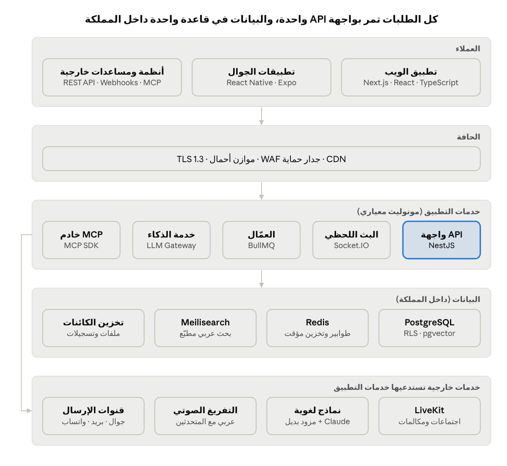

# كراسة المواصفات الفنية — نظام ترند TRend

> النسخة الأصلية: [trend-technical-spec.docx](trend-technical-spec.docx) — هذا الملف تحويل آلي للقراءة، والمرجع عند أي تعارض هو الأصل.

## 1. الملخص التنفيذي

تبني ترند نظاماً واحداً يجمع المهام والتواصل والاجتماعات وقياس الإنجاز، مفصّلاً على هيكلها التنظيمي، مع طبقة ذكاء اصطناعي تعمل على بياناتها دون أن تغادر بيئتها. تحدد هذه الكراسة ما يُبنى، وبأي تقنيات، وكيف يُختبر ويُقبل، دون التزام بمدد زمنية.

الفكرة المحورية: كل التزام داخل ترند له صاحب، وموعد، ومصدر، ودليل إنجاز قابل للقياس. الاجتماع ينتهي بمهام، والملاحظة تتحول إلى مهمة، والمهمة تُقاس، والقياس يُبنى على أرقام لا انطباعات.

### 1.1 أهداف النظام

| الهدف                      | المؤشر الذي يقيسه                                         | ملاحظة                          |
|---------------------------------------------------|----------------------------------------------------------------------------------|--------------------------------------------------------|
| تقليل اجتماعات المتابعة    | عدد اجتماعات المتابعة الأسبوعية                           | خط الأساس يُقاس في مرحلة التشخيص |
| رفع الالتزام بالمواعيد     | نسبة المهام المسلّمة في موعدها                             | تُحسب آلياً من لوحة الإنجاز       |
| عدم ضياع قرارات الاجتماعات | نسبة الالتزامات المستخرجة التي تحولت لمهام                | من وحدة مهام الاجتماع           |
| تجميع التواصل في مكان واحد | نسبة المراسلات الداخلية عبر النظام مقابل الأدوات الخارجية | استبيان + بيانات الاستخدام      |
| توفير وقت إنشاء المهام     | متوسط زمن إنشاء مهمة مكتملة البيانات                      | قبل وبعد المساعد الذكي          |

المستهدفات الرقمية لكل مؤشر تُعتمد بعد مرحلة التشخيص، لأن ترند لا تملك اليوم خط أساس مقيساً.

### 1.2 النطاق

داخل النطاق:

- منصة ويب كاملة، وتطبيقان أصليان لـ iOS وAndroid.

- اللوحات والمهام وبطاقة المهمة والقوالب.

- المحادثات الفردية والجماعية والاتصال التنبيهي.

- الاجتماعات المرئية الداخلية مع التسجيل والتفريغ والملخص واستخراج المهام.

- مساعد المهام الذكي والسكرتير التنفيذي.

- لوحة الإنجاز وسياسة الإنجاز القابلة للضبط.

- الملاحظات، والتقويم، والرئيسية الشخصية، والإشعارات.

- تذاكر الدعم الداخلي، ووحدة التوظيف والمقابلات الأولية.

- الصلاحيات والأدوار والهيكل التنظيمي والحوكمة.

- واجهات API وWebhooks وخادم MCP.

خارج النطاق (تكامل لاحق لا بناء): الرواتب، والمحاسبة، وإدارة علاقات العملاء الكاملة CRM، وأجهزة الحضور البيومترية.

### 1.3 الافتراضات المطلوب تأكيدها

- ☐ حجم ترند الحالي والمتوقع خلال سنتين (عدد المستخدمين والإدارات).

- ☐ النظام لاستخدام ترند الداخلي أولاً، مع معمارية جاهزة لتعدد المستأجرين إن قررت ترند تسويقه منتجاً لاحقاً.

- ☐ طبيعة عمل ترند (وكالة، تقنية، خدمات) لتحديد قوالب اللوحات الافتراضية.

- ☐ الأدوات الحالية التي يجب التكامل معها أو الهجرة منها.

- ☐ اشتراطات استضافة البيانات داخل المملكة.

### 1.4 المستفيدون

| الفئة                    | ماذا تحتاج من النظام                                     |
|-------------------------------------------------|---------------------------------------------------------------------------------|
| الإدارة العليا           | رؤية لحظية لكل المشاريع والأداء دون اجتماعات متابعة      |
| مديرو الإدارات           | توزيع المهام، المتابعة، التصعيد، تقييم الفريق            |
| الموظفون                 | معرفة المطلوب اليوم، التواصل، إنجاز المهام من الجوال     |
| الموارد البشرية          | الهيكل التنظيمي، التوظيف، تقارير الأداء                  |
| الضيوف (عملاء، متعاونون) | رؤية ما أُضيفوا إليه فقط لمدة محددة                       |
| مدير النظام              | المستخدمون، الفوترة، استهلاك الذكاء الاصطناعي، الإعدادات |

## 2. قراءة المرجع (ProPath) وما تضيفه ترند

يقدّم ProPath 23 قدرة تغطي الإدارة التشغيلية كاملة. ترند تأخذ الهيكل نفسه، وتطوّر ثماني نقاط فيه، وتضيف عشر قدرات غير موجودة في المرجع، مع إعادة ترتيب الأولويات لتناسب شركة صغيرة.

### 2.1 قراءة نقدية للمرجع

نقاط القوة التي نحتفظ بها:

- الذكاء الاصطناعي يقترح ولا يُنفّذ إلا بعد اعتماد بشري، في المساعد والسكرتير ومهام الاجتماع.

- القياس قائم على معادلة قابلة للضبط مع سجل زمني يحفظ التقارير السابقة بسياستها.

- التواصل يعيش داخل العمل بجوار المهمة والاجتماع.

- عربي أولاً، وتطبيقات أصلية، وصلاحيات متطابقة بين الويب والجوال.

الفجوات التي نعالجها:

- لا يوجد ربط صريح بين المهام والأهداف الاستراتيجية (OKR)؛ فالإنجاز يُقاس كمّاً دون أن نعرف أثره.

- لا توجد رؤية لعبء العمل والطاقة الاستيعابية؛ المدير يرى المتأخر لكن لا يرى من سيتأخر.

- التقييم بالأرقام وحدها قد يدفع لتضخيم المهام الصغيرة؛ لا توجد آلية اعتراض أو معايرة.

- لا يوجد مسار اعتمادات إداري خفيف (طلبات، موافقات).

- لا توجد قاعدة معرفة داخلية؛ الإجراءات المتكررة تبقى في رؤوس الأفراد.

- الاتصال التنبيهي على الجوال يصطدم بقيود Apple وGoogle (تفصيله في القسم 10).

### 2.2 مصفوفة القرار لكل قدرة

| \#  | القدرة في ProPath  | قرار ترند  | التطوير المقترح                                           |
|-----|-------------------------------------------|-----------------------------------|----------------------------------------------------------------------------------|
| 1   | اللوحات والمهام    | نأخذه      | عرض قائمة وجدول وجانت إلى جانب الكانبان                   |
| 2   | بطاقة المهمة       | نأخذه      | حقول مخصصة، تبعيات بين المهام، تقدير جهد                  |
| 3   | مساعد المهام الذكي | نطوّره      | فهم اللهجة السعودية صوتياً، وإنشاء مهام متعددة من طلب واحد |
| 4   | السكرتير التنفيذي  | نطوّره      | تقرير أسبوعي آلي لكل مدير، وتنبؤ بالمهام المعرّضة للتأخر   |
| 5   | الاجتماعات         | نأخذه      | جدول أعمال مسبق مرتبط بالمهام المفتوحة                    |
| 6   | مهام الاجتماع      | نأخذه      | ربط المهمة المستخرجة بالدقيقة في التسجيل                  |
| 7   | لوحة الإنجاز       | نطوّره      | ربط الإنجاز بالأهداف، ومؤشر عبء العمل                     |
| 8   | سياسة الإنجاز      | نطوّره      | آلية اعتراض ومعايرة دورية                                 |
| 9   | المحادثات          | نأخذه      | خيوط ردود (Threads) ورسائل مجدولة                         |
| 10  | الاتصال التنبيهي   | نطوّره      | تصميم متوافق مع سياسات المتاجر                            |
| 11  | تطبيق الجوال       | نأخذه      | وضع دون اتصال للمهام والملاحظات                           |
| 12  | التقويم والرئيسية  | نطوّره      | دعم التقويم الهجري وأوقات دوام رمضان                      |
| 13  | الصلاحيات والأدوار | نأخذه      | كما هو                                                    |
| 14  | الإشعارات          | نطوّره      | قناة واتساب رسمية، وملخص يومي مجمّع                        |
| 15  | الملاحظات          | نأخذه      | كما هو                                                    |
| 16  | تذاكر الدعم        | نأخذه      | اتفاقية مستوى خدمة SLA لكل نوع                            |
| 17  | التوظيف والمقابلات | نأخذه بحذر | مراجعة بشرية إلزامية لكل نتيجة                            |
| 18  | الحوكمة والانضباط  | نأخذه      | كما هو                                                    |
| 19  | الإدارة والتشغيل   | نأخذه      | كما هو                                                    |
| 20  | التكاملات والقوالب | نطوّره      | ربط Google Workspace وMicrosoft 365                       |
| 21  | الأمان والاستضافة  | نأخذه      | امتثال صريح لنظام حماية البيانات الشخصية                  |

### 2.3 قدرات تضيفها ترند

1.  الأهداف والنتائج الرئيسية OKR: هدف ← نتائج رئيسية ← مشاريع ← مهام، مع نسبة تقدّم محسوبة آلياً.

2.  عبء العمل والطاقة: خريطة حرارية لساعات كل موظف المقدّرة أسبوعياً، وتنبيه عند تجاوز الطاقة.

3.  الاعتمادات الإدارية: نماذج طلبات (إجازة، شراء، مصروف، استثناء) بمسار موافقة متعدد المستويات.

4.  قاعدة المعرفة: صفحات إجراءات وأدلة داخلية قابلة للبحث، يقرأ منها المساعد الذكي.

5.  بوابة العميل: دور ضيف موسّع يعتمد المخرجات ويعلّق عليها دون رؤية الحوار الداخلي.

6.  تقرير الأسبوع الآلي: ملخص لكل مدير صباح الأحد: ما أُنجز، ما تأخر، ما يتوقع تأخره، ومن يحتاج دعماً.

7.  التنبؤ بالتأخر: درجة خطر لكل مهمة مفتوحة بناءً على تاريخها وحمل صاحبها ونمط تأخراته.

8.  بوت واتساب: إنشاء مهمة أو الاستعلام عن مهامي برسالة نصية أو صوتية.

9.  تتبّع الوقت الاختياري: مؤقت على المهمة لمن يحتاجه (فرق الخدمات والمشاريع بالساعة).

10. الاعتراض والمعايرة: يعترض الموظف على تقييم محدد بسبب، ويحسم المدير الأعلى، ويُحفظ كل ذلك في السجل.

## 3. المتطلبات الوظيفية

النظام مكوّن من 16 وحدة، لكل متطلب رمز ثابت (FR-وحدة-رقم) يُستخدم في الاختبار والقبول والتتبّع. الأولوية وفق MoSCoW: M لازم للإطلاق، S مهم، C مرغوب.

### 3.1 الهيكل والمساحات (ORG)

- **FR-ORG-01 (M):** هرمية: الشركة ← مساحات العمل ← القطاعات ← الإدارات ← الأقسام ← الفرق ← الموظف.

- **FR-ORG-02 (M):** لكل موظف قسم أصلي ومدير مباشر، ويمكن ربطه بأقسام إضافية.

- **FR-ORG-03 (M):** دعوة بالبريد مع تحديد الدور والقسم في خطوة واحدة، واستيراد جماعي من CSV.

- **FR-ORG-04 (S):** مساحة خاصة لكل موظف لمهامه الشخصية لا يراها غيره.

- **FR-ORG-05 (S):** إعدادات أيام العمل وساعاته على مستوى الشركة والقسم، بما فيها دوام رمضان والإجازات الرسمية.

### 3.2 المشاريع واللوحات والمهام (TSK)

- **FR-TSK-01 (M):** المشروع يحوي لوحات، واللوحة تحوي أعمدة حالة قابلة للتسمية والترتيب (افتراضياً: للبدء، قيد التنفيذ، محجوبة، مكتملة، مؤرشفة).

- **FR-TSK-02 (M):** خمسة عروض للوحة نفسها: كانبان، قائمة، جدول، تقويم، جانت.

- **FR-TSK-03 (M):** سحب وإفلات المهام بين الأعمدة مع تحديث لحظي لكل المشاهدين.

- **FR-TSK-04 (M):** تصفية وفرز وتجميع حسب الحالة والأولوية والمكلّف وتاريخ الإنجاز والتصنيف والحقول المخصصة، مع حفظ العروض.

- **FR-TSK-05 (M):** عرض «مهامي» مرتب: المتأخر، ثم اليوم، ثم هذا الأسبوع، ثم لاحقاً.

- **FR-TSK-06 (S):** حقول مخصصة لكل لوحة: نص، رقم، تاريخ، قائمة منسدلة، شخص، رابط، عملة.

- **FR-TSK-07 (S):** تبعيات بين المهام (تنتهي قبل أن تبدأ)، وتنبيه عند تأخر مهمة تحجب غيرها.

- **FR-TSK-08 (S):** مهام متكررة (يومي، أسبوعي، شهري، مخصص).

- **FR-TSK-09 (C):** تقدير الجهد بالساعات أو النقاط، ومؤقت اختياري لتتبّع الوقت.

### 3.3 بطاقة المهمة (CRD)

- **FR-CRD-01 (M):** العنوان، الوصف بمحرر غني، الأولوية (منخفضة، متوسطة، عالية، عاجلة)، تاريخ ووقت الإنجاز، التصنيفات.

- **FR-CRD-02 (M):** عدة مكلّفين مع نجمة تحدد المسؤول الأول عن التسليم.

- **FR-CRD-03 (M):** قائمة مهام فرعية (نقاط تسليم) بنسبة إنجاز ظاهرة، مع توليدها بالذكاء الاصطناعي.

- **FR-CRD-04 (M):** تعليقات بإشارة @ تصل لصاحبها، وردود، وتفاعلات.

- **FR-CRD-05 (M):** مرفقات حتى 25 ميجابايت للملف مع معاينة الصور وPDF.

- **FR-CRD-06 (M):** سجل تغييرات غير قابل للحذف: كل نقل وتعديل بصاحبه ووقته وقيمته قبل وبعد.

- **FR-CRD-07 (S):** إخفاء مهمة عن أعضاء اللوحة إلا المكلّفين ومن يحددهم المالك.

- **FR-CRD-08 (S):** حماية محتوى المهمة برمز إضافي (أوصاف ومرفقات وتعليقات حساسة).

- **FR-CRD-09 (S):** ربط المهمة بنتيجة رئيسية (OKR) وبمصدرها (اجتماع، ملاحظة، تذكرة، محادثة).

### 3.4 المحادثات (CHT)

- **FR-CHT-01 (M):** محادثات فردية وجماعية وقنوات مرتبطة بالمشروع أو القسم.

- **FR-CHT-02 (M):** نص، صوت، صور، ملفات، تحويل رسالة، تثبيت، إشارة @، حالة القراءة.

- **FR-CHT-03 (M):** بحث داخل نص الرسائل بالعربية مع تجاهل التشكيل والهمزات.

- **FR-CHT-04 (M):** فلاتر: غير المقروء، المثبّت، المجموعات، الفردية.

- **FR-CHT-05 (S):** صور تُعرض مرة واحدة ثم تختفي، مع منع لقطة الشاشة حيث تسمح المنصة.

- **FR-CHT-06 (S):** الرد من الإشعار مباشرة، ونافذة محادثة عائمة على الويب.

- **FR-CHT-07 (S):** خيوط ردود، ورسائل مجدولة، وتحويل أي رسالة إلى مهمة.

- **FR-CHT-08 (S):** الاتصال التنبيهي بسبب مختصر، وحدود يومية وفاصل زمني وصلاحية خاصة.

### 3.5 الاجتماعات (MTG)

- **FR-MTG-01 (M):** جدولة اجتماع بأعضاء وجدول أعمال، مع دعوة ضيوف خارجيين برابط.

- **FR-MTG-02 (M):** غرفة مرئية داخل النظام: صوت، فيديو، مشاركة شاشة، دردشة.

- **FR-MTG-03 (M):** سياسة اجتماعات للشركة: متى تُفتح الغرفة، مهلة الانتهاء، التسجيل الافتراضي، السماح للضيوف.

- **FR-MTG-04 (M):** تسجيل وتفريغ نصي بالعربية مع تمييز المتحدثين.

- **FR-MTG-05 (M):** ملخص تنفيذي: القرارات، المخاطر، الالتزامات، وملخص خاص لكل من غاب.

- **FR-MTG-06 (S):** جلب التسجيل والتفريغ آلياً من Google Meet وZoom وMicrosoft Teams وأدوات التفريغ الخارجية.

- **FR-MTG-07 (S):** اعتماد حضور الاجتماع آلياً بعد انتهائه.

### 3.6 مهام الاجتماع (MTA)

- **FR-MTA-01 (M):** استخراج كل التزام إلى مهمة مقترحة بعنوان ومسؤول وموعد وأولوية.

- **FR-MTA-02 (M):** عرض الاقتباس الأصلي بجوار كل مهمة، مع رابط للحظة في التسجيل.

- **FR-MTA-03 (M):** مراجعة مهمة بمهمة: حوّل وتابع، عدّل، تخطَّ مؤقتاً، ارفض.

- **FR-MTA-04 (M):** المهام المستخرجة تنتظر صاحب الاجتماع على الويب والجوال حتى يُراجعها.

### 3.7 لوحة الإنجاز وسياسته (PRF)

- **FR-PRF-01 (M):** نظرة الكيان: مهام جديدة، مغلقة، مفتوحة، متأخرة، معاد فتحها، مؤرشفة، محذوفة، لأي فترة.

- **FR-PRF-02 (M):** أبرز المنجزين بالنقاط الموزونة، وتوزيع المهام حسب الحالة.

- **FR-PRF-03 (M):** مؤشرات الجودة: التسليم في الموعد، النجاح من المرة الأولى (دون إعادة فتح)، الاعتمادية، الإنتاجية.

- **FR-PRF-04 (M):** سياسة إنجاز قابلة للضبط: أوزان المصادر، معاملات الأدوار (مسؤول أول، مكلّف فرعي)، وزن الموعد، وزن الجودة.

- **FR-PRF-05 (M):** سجل زمني للسياسات؛ كل تقرير يُحسب بالسياسة السارية وقت صدوره.

- **FR-PRF-06 (S):** سياسة مؤقتة لموظف بعينه (إجازة مرضية، مهمة خاصة) تعود بعدها للعامة.

- **FR-PRF-07 (S):** مؤشر عبء العمل الأسبوعي لكل موظف مقابل طاقته.

- **FR-PRF-08 (S):** اعتراض موثّق على تقييم فترة، يحسمه المدير الأعلى.

- **FR-PRF-09 (S):** تصدير التقارير PDF وExcel.

### 3.8 الأهداف OKR

- **FR-OKR-01 (S):** أهداف على مستوى الشركة والإدارة والفرد لكل ربع.

- **FR-OKR-02 (S):** نتائج رئيسية رقمية أو ثنائية، تُحدَّث يدوياً أو من نسبة إنجاز المهام المرتبطة.

- **FR-OKR-03 (C):** شجرة محاذاة تربط أهداف الأفراد بأهداف الشركة.

### 3.9 الملاحظات وقاعدة المعرفة (NTE)

- **FR-NTE-01 (M):** ملاحظات ملوّنة ومحاضر اجتماعات في مجلدات مع وسوم.

- **FR-NTE-02 (M):** تحويل الملاحظة إلى مهمة بعنوانها ووصفها بضغطة.

- **FR-NTE-03 (S):** مشاركة الملاحظة، وإظهار ما تغيّر منذ آخر زيارة.

- **FR-NTE-04 (S):** صفحات معرفة (إجراءات وأدلة) بصلاحيات، يستخدمها المساعد الذكي مرجعاً.

### 3.10 التقويم والرئيسية (HOM)

- **FR-HOM-01 (M):** تقويم المهام: شهري، أسبوعي، 3 أيام، يومي، مع تصفية بالحالة والأولوية.

- **FR-HOM-02 (M):** رئيسية شخصية: تحية، المتأخر، مستحق اليوم، اجتماعاتي القادمة، مؤشرات المفتوح والمنجز.

- **FR-HOM-03 (M):** شريط جانبي للمهام غير المجدولة حتى لا تُنسى.

- **FR-HOM-04 (S):** عرض التاريخ الهجري بجوار الميلادي، ومزامنة ثنائية مع Google Calendar وOutlook.

- **FR-HOM-05 (S):** تخصيص بطاقات الرئيسية ومؤشراتها لكل فريق.

### 3.11 الاعتمادات الإدارية (APR)

- **FR-APR-01 (S):** منشئ نماذج طلبات بحقول وقواعد.

- **FR-APR-02 (S):** مسار موافقة متسلسل أو متوازٍ حسب الهيكل (المدير المباشر ← مدير الإدارة ← المالية).

- **FR-APR-03 (S):** اعتماد أو رفض بسبب، وتفويض عند الغياب، وسجل كامل.

### 3.12 تذاكر الدعم (SUP)

- **FR-SUP-01 (M):** تذكرة يدوية (موضوع حتى 200 حرف، تفاصيل حتى 10,000 حرف، حتى 20 مرفقاً) أو عبر محادثة مع مساعد يصوغها.

- **FR-SUP-02 (M):** مرفقات صوت وتسجيل شاشة من المتصفح والجوال.

- **FR-SUP-03 (M):** دورة حياة: جديدة، قيد الفرز، قيد المعالجة، بانتظار صاحبها، مغلقة (محلولة، مجدولة، مرفوضة بسبب).

- **FR-SUP-04 (S):** اتفاقية مستوى خدمة لكل نوع وأولوية، وتصعيد عند تجاوزها.

### 3.13 التوظيف والمقابلات (HIR)

- **FR-HIR-01 (S):** إنشاء مقابلة: المسمى، الوصف الوظيفي، ملف الأداء المرجعي، اسم المتقدم وبريده.

- **FR-HIR-02 (S):** رابط خاص لكل متقدم صالح 72 ساعة، يتوقف بعد إتمام المقابلة.

- **FR-HIR-03 (S):** الذكاء الاصطناعي يدير مقابلة نصية أو صوتية بأسئلة مبنية على الدور، ولا تُعرض بيانات الأداء المرجعي للمتقدم.

- **FR-HIR-04 (M إذا فُعّلت الوحدة):** النتيجة تقرير توصية فقط، والقرار بشري إلزامياً، مع إشعار المتقدم بأن المحاور آلي.

### 3.14 الحوكمة والانضباط (GOV)

- **FR-GOV-01 (M):** تعديل تاريخ الإنجاز يمر بمسار اعتماد ومهلة محددة.

- **FR-GOV-02 (M):** تصعيد تلقائي للمهام المتأخرة لمن يلزم (المدير المباشر، ثم الأعلى) حسب قواعد قابلة للضبط.

- **FR-GOV-03 (M):** سلة محذوفات مع استرجاع، وتأكيد قبل الحذف النهائي.

- **FR-GOV-04 (M):** إعدادات لكل لوحة: تثبيت عمود المنتهية، ترتيب تلقائي، تاريخ إنجاز إجباري، وقت إجباري.

### 3.15 الإدارة والتشغيل (ADM)

- **FR-ADM-01 (M):** الأعضاء والدعوات والأدوار والأقسام.

- **FR-ADM-02 (M):** مقاعد الضيوف حصة مستقلة لا تُحتسب من مقاعد الموظفين.

- **FR-ADM-03 (M):** صفحة الفوترة والاستهلاك: الباقة، المقاعد، استهلاك الذكاء الاصطناعي لكل وحدة ومستخدم.

- **FR-ADM-04 (M):** لغتان (عربي وإنجليزي)، وضع فاتح وداكن، حجم خط قابل للضبط.

### 3.16 القوالب (TPL)

- **FR-TPL-01 (S):** قالب سير عمل متكرر بخطوات متتابعة أو متوازية ومدد افتراضية لكل خطوة.

- **FR-TPL-02 (S):** إنشاء كل مهام القالب بضغطة، مع حساب التواريخ من تاريخ البداية.

- **FR-TPL-03 (C):** مكتبة قوالب جاهزة حسب طبيعة عمل ترند (حملة تسويقية، إطلاق منتج، تعيين موظف).

## 4. طبقة الذكاء الاصطناعي

الذكاء الاصطناعي في ترند خدمة داخلية واحدة (AI Service) تمر عبرها كل الاستدعاءات، وقاعدتها الحاكمة: يقترح، والإنسان يعتمد، والنظام يسجّل. لا يُنشئ الذكاء الاصطناعي ولا يرسل ولا يحذف شيئاً دون إجراء بشري صريح أو صلاحية مسبقة محددة السقف.

### 4.1 حالات الاستخدام

| الحالة                | المدخل                                          | المخرج                                                | بوابة الاعتماد                |
|----------------------------------------------|------------------------------------------------------------------------|------------------------------------------------------------------------------|------------------------------------------------------|
| مساعد المهام          | نص، صوت، ملف                                    | مهمة أو عدة مهام بعنوان ووصف ومكلّف وموعد ومشروع ولوحة | المستخدم يعتمد كل مهمة        |
| توليد المهام الفرعية  | عنوان المهمة ووصفها                             | قائمة نقاط تسليم                                      | المستخدم يعتمد أو يعدّل        |
| تفريغ الاجتماع        | تسجيل صوتي                                      | نص بالعربية مع المتحدثين والأوقات                     | لا يلزم                       |
| ملخص الاجتماع         | التفريغ + جدول الأعمال                          | قرارات، مخاطر، التزامات، ملخص للغائبين                | صاحب الاجتماع يراجع قبل النشر |
| استخراج مهام الاجتماع | التفريغ                                         | مهام مقترحة مع الاقتباس والدقيقة                      | مراجعة مهمة بمهمة             |
| السكرتير التنفيذي     | نشاط الفريق، المتأخر، الرسائل غير المردود عليها | بطاقات «هل ترغب أن أعمل لك كذا؟» (5 بحد أقصى يومياً)   | المدير يوافق على كل إجراء     |
| تقرير الأسبوع         | بيانات الإنجاز للفريق                           | ملخص مكتوب لكل مدير                                   | للقراءة فقط                   |
| صياغة تذكرة الدعم     | محادثة مع المستخدم                              | تذكرة مكتملة الحقول                                   | المستخدم يرسل                 |
| المقابلة الأولية      | الوصف الوظيفي + ملف الأداء المرجعي              | محاورة المتقدم + تقرير توصية                          | قرار بشري إلزامي              |
| البحث الذكي           | سؤال بلغة طبيعية                                | إجابة مستندة لمهام وملاحظات وصفحات معرفة مع روابطها   | للقراءة فقط                   |
| بوت واتساب            | رسالة نصية أو صوتية                             | إنشاء مهمة أو عرض «مهامي»                             | تأكيد برسالة قبل الإنشاء      |

### 4.2 مكونات الخدمة

1.  بوابة النماذج (LLM Gateway): طبقة تجريد واحدة فوق مزودي النماذج، تتيح تبديل المزود دون تعديل الوحدات. تتولى التوجيه، وإعادة المحاولة، والحدود اليومية، وتسجيل الاستهلاك لكل مستخدم ووحدة.

2.  توجيه حسب المهمة: نموذج كبير عالي الجودة للملخصات والاستخراج والمقابلات، ونموذج صغير سريع للتصنيف وتوليد المهام الفرعية والاقتراحات القصيرة.

3.  مخرجات مهيكلة: كل استدعاء يعيد JSON مطابقاً لمخطط Zod محدد، ويُرفض أي مخرج لا يطابقه ويُعاد طلبه مرة واحدة.

4.  استدعاء الأدوات (Tool Use): المساعد يستعلم عن المشاريع والأعضاء والمواعيد من بيانات ترند بأدوات للقراءة فقط، مقيّدة بصلاحيات المستخدم الذي يطلب.

5.  الاسترجاع المعزّز RAG: فهرسة المهام والملاحظات وصفحات المعرفة وتفريغات الاجتماعات بمتجهات في PostgreSQL (pgvector)، مع تصفية بالصلاحيات قبل الاسترجاع لا بعده.

6.  التعرّف على الكلام: محرك تفريغ يدعم العربية الفصحى واللهجة السعودية مع تمييز المتحدثين.

7.  سجل الذكاء الاصطناعي: كل طلب يُحفظ بمدخله المختصر ومخرجه والنموذج والتكلفة والقرار البشري عليه (اعتُمد، عُدّل، رُفض).

### 4.3 مثال: مخطط استخراج مهام الاجتماع

{  
"tasks": \[  
{  
"title": "إنهاء ترحيل جدول الفواتير",  
"description": "استكمال ترحيل جدول الفواتير إلى الخادم الجديد",  
"assignee_user_id": "usr\_...",  
"assignee_confidence": 0.92,  
"due_date": "2026-10-22",  
"priority": "medium",  
"project_id": "prj\_...",  
"board_id": "brd\_...",  
"source_quote": "عمر: سأنهي الفواتير اليوم",  
"source_timestamp_sec": 1834  
}  
\],  
"decisions": \["..."\],  
"risks": \["..."\]  
}

إذا قلّت ثقة النموذج في المكلّف عن 0.7، يُترك الحقل فارغاً ويُطلب من المراجع تحديده بدل التخمين.

### 4.4 معادلة الإنجاز

درجة الموظف في فترة هي مجموع نقاط مهامه المغلقة، كل مهمة موزونة بمصدرها ودوره فيها، ثم بمعاملات الموعد والجودة التي تحددها سياسة الإنجاز السارية:

S_u = \frac{\sum\_{t \in T_u} W\_{src}(t) \cdot R\_{role}(u,t) \cdot \left( \alpha \cdot D(t) + \beta \cdot Q(t) \right) \cdot C(t)}{\sum\_{t \in T_u} W\_{src}(t) \cdot R\_{role}(u,t) \cdot C(t)} \times 100

- W_src: وزن مصدر المهمة (اجتماع، مدير، ذاتية، تذكرة).

- R_role: معامل الدور (المسؤول الأول أعلى من المكلّف الفرعي).

- D: درجة الموعد (1 في الموعد، تتناقص مع أيام التأخير حتى حد أدنى).

- Q: درجة الجودة (1 إن لم يُعَد فتح المهمة، وتقل مع كل إعادة فتح).

- C: معامل الصعوبة (من تقدير الجهد أو الأولوية).

- α + β = 1، وتُضبط من صفحة السياسة.

المعادلة تُحفظ بإصدار، وكل تقرير يخزّن رقم إصدار السياسة الذي حُسب به.

### 4.5 التنبؤ بالتأخر

يبدأ كنموذج قواعد بسيط قابل للتفسير، ثم يتحول إلى نموذج انحدار لوجستي بعد تراكم بيانات كافية. المدخلات: الأيام المتبقية مقابل نسبة المهام الفرعية المنجزة، حمل المكلّف الحالي، نسبة تأخره التاريخية، عدد مرات تعديل الموعد، وجود تبعية محجوبة. المخرج درجة من 0 إلى 100 مع سبب مكتوب، ولا تدخل هذه الدرجة في تقييم الموظف إطلاقاً.

### 4.6 ضوابط الجودة والتكلفة

- مجموعة تقييم ثابتة: 50 تفريغ اجتماع عربي حقيقي مع المهام الصحيحة يدوياً، تُشغّل عند كل تغيير في النموذج أو التعليمات. مقاييسها: دقة المكلّف، دقة الموعد، نسبة الالتزامات المفقودة.

- إصدارات للتعليمات (Prompts): محفوظة في المستودع، ولكل إصدار نتيجة تقييم مسجّلة.

- حدود الاستهلاك: سقف يومي لكل مستخدم وسقف شهري للشركة، مع تنبيه عند 80%.

- التخزين المؤقت: نتائج الملخصات والفهرسة لا يُعاد حسابها إلا عند تغيّر المصدر.

- الخصوصية: التعاقد مع مزود النماذج على عدم استخدام البيانات للتدريب وعدم الاحتفاظ بها، وحذف المعرّفات الشخصية غير اللازمة قبل الإرسال.

- قابلية الإيقاف: مفتاح لإيقاف كل وحدة ذكاء اصطناعي على مستوى الشركة أو المستخدم.

## 5. المعمارية التقنية

النمط المعتمد مونوليث معياري (Modular Monolith): تطبيق خادم واحد مقسّم داخلياً إلى وحدات بحدود صارمة، لا خدمات مصغّرة. هذا يناسب فريقاً صغيراً: نشر واحد، ومعاملات قاعدة بيانات بسيطة، وقابلية فصل أي وحدة لاحقاً إن احتاجت توسعاً مستقلاً.

معمارية نظام ترند · 5 طبقات

العملاء الثلاثة يستخدمون الواجهة البرمجية نفسها، وكل البيانات في PostgreSQL واحدة داخل المملكة، والخدمات الخارجية تُستدعى من خدمات التطبيق فقط ولا يتصل بها العميل مباشرة.

### 5.1 وحدات الخادم

| الوحدة | المسؤولية                                             | تتواصل مع                    |
|-------------------------------|------------------------------------------------------------------------------|-----------------------------------------------------|
| identity                      | المستخدمون، المصادقة، الجلسات، المصادقة الثنائية      | الكل                         |
| org                           | المساحات، الهيكل، الأدوار، الصلاحيات، أيام العمل      | الكل                         |
| work                          | المشاريع، اللوحات، المهام، البطاقة، القوالب، التبعيات | notifications، performance، ai                      |
| governance                    | اعتماد تعديل المواعيد، التصعيد، سلة المحذوفات         | work، notifications                                 |
| messaging                     | المحادثات، الرسائل، الاتصال التنبيهي                  | realtime، notifications                             |
| meetings                      | الاجتماعات، الغرف، التسجيلات، المهام المستخرجة        | ai، work                                            |
| performance                   | السياسات، اللقطات، الاعتراض، عبء العمل، OKR           | work                                                |
| knowledge                     | الملاحظات، قاعدة المعرفة، الفهرسة                     | ai، work                                            |
| services                      | التذاكر، الاعتمادات، التوظيف                          | ai، notifications                                   |
| ai                            | البوابة، التعليمات، الاسترجاع، سجل الاستهلاك          | الكل (للقراءة عبر الصلاحيات) |
| notifications                 | القواعد، التفضيلات، القنوات، الملخص اليومي            | الكل                         |
| integrations                  | API العامة، Webhooks، MCP، التكاملات                                         | الكل                         |
| audit                         | سجل التدقيق غير القابل للتعديل                        | الكل                         |

قاعدة الحدود: الوحدة لا تقرأ جداول وحدة أخرى مباشرة؛ تستدعي واجهتها الداخلية أو تستمع لأحداثها. هذا ما يجعل فصلها لاحقاً ممكناً.

### 5.2 الأحداث الداخلية

كل تغيير مهم ينشر حدثاً داخلياً (مثل task.moved) يُكتب في جدول صادر (Outbox) داخل المعاملة نفسها، ثم يوزّعه عامل خلفي على المستمعين: الإشعارات، الوقت الحقيقي، الفهرسة، Webhooks، الأداء. بهذا لا يضيع حدث إن تعطل أحد المستمعين، ولا يُرسل حدث لتغيير فشلت معاملته.

### 5.3 مثال تدفق: مهمة من رسالة صوتية

1.  الموظف يسجل على الجوال: «اجتماع مع فريق التسويق الخميس لمراجعة حملة الإطلاق، وكلّف هند بإعداد العرض قبل الأربعاء».

2.  التطبيق يرفع الصوت إلى تخزين الكائنات برابط موقّع، ثم يستدعي POST /api/v1/ai/task-drafts.

3.  خدمة الذكاء تفرّغ الصوت، ثم تستدعي النموذج مع أدوات قراءة المشاريع والأعضاء في نطاق صلاحية الموظف.

4.  النموذج يعيد مسودتين: اجتماع يوم الخميس، ومهمة لهند بموعد الأربعاء في مشروع «حملة الإطلاق».

5.  التطبيق يعرض المسودتين للمراجعة؛ الموظف يعدّل ويعتمد.

6.  وحدة work تنشئ المهمة والاجتماع، وتنشر الأحداث؛ هند يصلها إشعار، واللوحة تتحدث لحظياً عند كل من يفتحها.

### 5.4 الجاهزية لتعدد المستأجرين

ترند تبدأ مستأجراً وحيداً، لكن كل جدول يحمل معرّف المستأجر، وكل اتصال بقاعدة البيانات يضبط app.tenant_id قبل أي استعلام، وسياسات RLS تمنع رؤية بيانات مستأجر آخر حتى لو أخطأ الكود. إن قررت ترند تسويق النظام، يُضاف مستأجرون جدد دون إعادة بناء، ويمكن لاحقاً عزل عميل كبير في قاعدة مستقلة دون تغيير الكود.

## 6. حزمة التقنيات

الاختيار الحاكم: TypeScript من الطرف إلى الطرف (الويب والجوال والخادم)، لأن شركة صغيرة تحتاج فريقاً واحداً يتنقل بين الطبقات، ومخططات بيانات مشتركة تمنع التعارض بين الواجهة والخادم. كل مكوّن مفتوح المصدر أو قابل للاستبدال، فلا ارتهان لمزود واحد.

### 6.1 الواجهة الأمامية (الويب)

| المكوّن          | الاختيار               | المبرر                                               | البديل                 |
|----------------------------------------|-----------------------------------------------|-----------------------------------------------------------------------------|-----------------------------------------------|
| إطار العمل      | Next.js (App Router) + React                  | عرض من الخادم، توجيه، أداء جيد، مجتمع ضخم            | Remix، أو Vite + React Router                 |
| اللغة           | TypeScript (strict)                           | أمان الأنواع ومشاركة الأنواع مع الخادم               | —                                             |
| التنسيق         | Tailwind CSS مع الخصائص المنطقية (start/end)  | دعم RTL أصيل دون ملفات CSS مزدوجة                    | CSS Modules                                   |
| مكتبة المكونات  | shadcn/ui فوق Radix UI                        | مكونات قابلة للوصول ومملوكة للمشروع لا كمكتبة خارجية | Mantine                                       |
| حالة الخادم     | TanStack Query                                | تخزين مؤقت، تحديث متفائل، إعادة جلب                  | SWR                                           |
| حالة الواجهة    | Zustand                                       | خفيف وبسيط                                           | Jotai                                         |
| النماذج والتحقق | React Hook Form + Zod                         | المخطط نفسه يُستخدم في الخادم                         | —                                             |
| السحب والإفلات  | dnd-kit                                       | يدعم RTL واللمس ولوحة المفاتيح                       | —                                             |
| المحرر الغني    | Tiptap (فوق ProseMirror)                      | إشارات @، جداول، تحرير تعاوني لاحقاً عبر Yjs          | Lexical                                       |
| الرسوم البيانية | Recharts أو Apache ECharts                    | ECharts أقوى مع البيانات الكبيرة ويدعم RTL                                  | visx                                          |
| الجانت والتقويم | FullCalendar + مكوّن جانت                      | عروض التقويم الجاهزة                                 | Bryntum (تجاري)                               |
| الترجمة         | next-intl                                     | رسائل ICU وصيغ الجمع العربية                         | i18next                                       |
| الخط            | IBM Plex Sans Arabic أو Tajawal أو Readex Pro | خطوط عربية مفتوحة الترخيص واضحة على الشاشة           | خط ترند المؤسسي إن وُجد |

### 6.2 تطبيقات الجوال

| المكوّن            | الاختيار                              | المبرر                                                           |
|------------------------------------------|--------------------------------------------------------------|-----------------------------------------------------------------------------------------|
| الإطار            | React Native عبر Expo (المعمارية الجديدة)                    | واجهات أصلية لا WebView، ومشاركة منطق الأعمال والأنواع مع الويب  |
| التوجيه           | Expo Router                                                  | توجيه بالملفات وروابط عميقة جاهزة                                |
| التخزين المحلي    | WatermelonDB أو SQLite عبر expo-sqlite                       | وضع دون اتصال ومزامنة                                            |
| الإشعارات         | expo-notifications فوق APNs وFCM                             | إشعارات تفاعلية بأزرار ورد مباشر                                 |
| الاتصالات المرئية | LiveKit React Native SDK                                     | الاجتماعات والمكالمات داخل التطبيق                               |
| الويدجت           | WidgetKit (Swift) لـ iOS وJetpack Glance (Kotlin) لـ Android | الويدجت لا يُبنى بـ React Native، فيُكتب أصلياً ويقرأ من مخزن مشترك |
| النشر والتحديث    | EAS Build وEAS Update                                        | بناء سحابي، وتحديثات فورية للمنطق دون انتظار مراجعة المتجر       |
| الاختبار          | Maestro                                                      | اختبارات واجهة شاملة على الجهازين                                |

بديل مدروس: Swift وKotlin أصليان بالكامل. أفضل أداءً قليلاً، لكنه يضاعف الفريق والتكلفة. لا يُنصح به لشركة بحجم ترند إلا إن كانت التطبيقات منتجها الأساسي.

### 6.3 الخادم

| المكوّن          | الاختيار              | المبرر                                                                 | البديل |
|----------------------------------------|----------------------------------------------|-----------------------------------------------------------------------------------------------|-------------------------------|
| بيئة التشغيل    | Node.js بإصدار LTS                           | TypeScript مشتركة مع الواجهات                                                                 | Bun                           |
| الإطار          | NestJS                                       | وحدات واضحة، حقن تبعيات، حراس صلاحيات، مناسب للمونوليث المعياري        | Fastify مباشرة                |
| الوصول للبيانات | Drizzle ORM                                  | استعلامات SQL واضحة، ترحيلات مُدارة، أداء جيد                           | Prisma                        |
| التحقق          | Zod (مخططات مشتركة مع الواجهة)               | مصدر واحد لشكل البيانات                                                | class-validator               |
| توثيق الواجهات  | OpenAPI 3.1 مولّد من الكود                    | عقد واضح للتكاملات وتوليد SDK                                          | —                             |
| المهام الخلفية  | BullMQ فوق Redis                             | التذكيرات، التصعيد، الإشعارات، معالجة الذكاء الاصطناعي، إعادة المحاولة | Temporal للمسارات الطويلة     |
| الوقت الحقيقي   | Socket.IO مع Redis Adapter                   | المحادثات والتحديث اللحظي للوحات عبر عدة خوادم                         | Centrifugo، أو Ably مُداراً     |
| المصادقة        | Better Auth أو Keycloak                      | كلمة مرور، OTP، Google وMicrosoft SSO، TOTP، SAML لاحقاً                | Auth0 مُداراً                   |
| الصلاحيات       | CASL للسياسات + أمن الصفوف RLS في PostgreSQL | فحص مزدوج في التطبيق وقاعدة البيانات                                   | OpenFGA                       |

### 6.4 البيانات والتخزين

| المكوّن                   | الاختيار                  | الاستخدام                                             |
|-------------------------------------------------|--------------------------------------------------|------------------------------------------------------------------------------|
| قاعدة البيانات الرئيسية  | PostgreSQL (أحدث إصدار مستقر)                    | كل البيانات المعاملاتية، مع RLS وJSONB للحقول المخصصة |
| المتجهات                 | pgvector داخل PostgreSQL نفسه                    | البحث الدلالي وRAG دون قاعدة منفصلة                   |
| البحث النصي              | Meilisearch                                      | بحث عربي سريع متسامح مع الأخطاء ومع التشكيل والهمزات  |
| التخزين المؤقت والطوابير | Redis أو Valkey                                  | الجلسات، الحدود، الطوابير، الوقت الحقيقي              |
| الملفات                  | تخزين كائنات متوافق مع S3 | المرفقات والتسجيلات، بروابط موقّعة مؤقتة               |
| المعالجة                 | FFmpeg + Sharp                                   | ضغط الصوت والفيديو والصور ومعاينات                    |
| فحص الملفات              | ClamAV                                           | فحص كل مرفق قبل إتاحته                                |

### 6.5 الاجتماعات والذكاء الاصطناعي

| المكوّن                 | الاختيار                                                                    | الاستخدام                                            |
|-----------------------------------------------|----------------------------------------------------------------------------------------------------|-----------------------------------------------------------------------------|
| خادم الاتصالات المرئية | LiveKit (استضافة ذاتية أو سحابي)                                                                   | غرف الاجتماعات والمكالمات عبر WebRTC                 |
| التسجيل                | LiveKit Egress                                                                                     | تسجيل الغرفة إلى تخزين الكائنات                      |
| التفريغ الصوتي         | مزود يدعم العربية مع تمييز المتحدثين (يُختار باختبار مقارن على تسجيلات ترند) | تفريغ الاجتماعات والرسائل الصوتية وأوامر المساعد     |
| النماذج اللغوية        | Claude عبر Anthropic API نموذجاً رئيسياً، مع مزود ثانٍ احتياطي عبر البوابة                            | الاستخراج والتلخيص والمساعد والمقابلات               |
| التضمينات              | نموذج تضمين متعدد اللغات يدعم العربية                                       | فهرسة المحتوى للبحث الدلالي                          |
| خادم MCP               | MCP TypeScript SDK                                                                                 | ربط مساعدات الذكاء الاصطناعي الخارجية بحساب المستخدم |

### 6.6 الاتصالات الخارجية

| القناة         | الاختيار                                  | ملاحظة                                            |
|---------------------------------------|------------------------------------------------------------------|--------------------------------------------------------------------------|
| البريد         | Amazon SES أو Postmark أو Resend                                 | مع SPF وDKIM وDMARC لنطاق ترند                    |
| الرسائل النصية | مزود سعودي مرخّص (مثل Unifonic أو Taqnyat) | اسم مرسل مسجّل لدى هيئة الاتصالات                  |
| واتساب         | WhatsApp Business Cloud API                                      | قوالب معتمدة من Meta للإشعارات خارج نافذة 24 ساعة |
| إشعارات الجوال | APNs وFCM                                                        | —                                                                        |

### 6.7 أدوات التطوير والتشغيل

| المجال          | الاختيار                                                                       |
|----------------------------------------|-------------------------------------------------------------------------------------------------------|
| المستودع        | Monorepo بـ pnpm وTurborepo (تطبيقات: web، mobile، api، worker؛ حزم مشتركة: types، schemas، ui، i18n) |
| جودة الكود      | ESLint، Prettier، Husky، Commitlint                                                                   |
| الاختبارات      | Vitest للوحدات، Supertest للواجهات، Playwright للويب، Maestro للجوال، k6 للأحمال                      |
| الحاويات        | Docker، وKubernetes مُدار عند الحاجة أو منصة حاويات مُدارة في البداية                                   |
| البنية ككود     | Terraform أو OpenTofu                                                                                 |
| التكامل المستمر | GitHub Actions                                                                                        |
| المراقبة        | OpenTelemetry، Grafana مع Prometheus وLoki وTempo، وSentry للأخطاء                                    |
| تحليلات المنتج  | PostHog (استضافة ذاتية)                                                                               |
| إدارة الأسرار   | Doppler أو Vault أو خدمة أسرار المزود السحابي                                                         |

## 7. نموذج البيانات

قاعدة PostgreSQL واحدة بنحو 40 جدولاً موزعة على 9 نطاقات. كل جدول يحمل tenant_id حتى لو بدأت ترند مستأجراً وحيداً، لأن إضافته لاحقاً أغلى بكثير من إضافته الآن.

### 7.1 قواعد عامة لكل الجداول

- المعرّفات: UUIDv7 (مرتبة زمنياً تحسّن أداء الفهارس)، وتُعرض للخارج ببادئة نوع: tsk\_، prj\_، usr\_.

- الأعمدة الإلزامية: id، tenant_id، created_at، updated_at، created_by.

- الحذف: ناعم عبر deleted_at للكيانات التي لها سلة محذوفات، ونهائي بعد مدة الاحتفاظ.

- التوقيت: كل الأوقات timestamptz بتوقيت UTC، والعرض بتوقيت المستخدم (الافتراضي Asia/Riyadh).

- الحقول المخصصة: عمود custom_fields من نوع JSONB مع فهرس GIN، وتعريفاتها في جدول مستقل.

- السجل: كل تعديل على الكيانات الأساسية يكتب صفاً في audit_events داخل المعاملة نفسها.

### 7.2 الكيانات الرئيسية

| النطاق     | الجدول                     | أهم الحقول                                                                                                                   | ملاحظات                      |
|-----------------------------------|---------------------------------------------------|-----------------------------------------------------------------------------------------------------------------------------------------------------|-----------------------------------------------------|
| الهوية     | tenants                                           | name، plan، settings، data_region                                                                                                                   | الشركة (ترند)                |
| الهوية     | users                                             | email، phone، name_ar، name_en، locale، timezone، status                                                                                            | —                                                   |
| الهوية     | memberships                                       | user_id، workspace_id، role، org_unit_id، manager_id، guest_expires_at                                                                              | ربط المستخدم بالمساحة ودوره  |
| الهوية     | sessions، mfa_factors، api_keys                   | —                                                                                                                                                   | المفاتيح مخزنة كتجزئة فقط    |
| الهيكل     | workspaces                                        | name، identity، settings                                                                                                                            | —                                                   |
| الهيكل     | org_units                                         | parent_id، type (قطاع، إدارة، قسم، فريق)، head_user_id                                                                                              | شجرة بمسار ltree             |
| الهيكل     | work_calendars                                    | weekdays، hours، holidays، ramadan_hours                                                                                                            | أيام العمل وساعاته           |
| العمل      | projects                                          | workspace_id، name، owner_id، visibility                                                                                                            | —                                                   |
| العمل      | boards                                            | project_id، name، settings (تاريخ إجباري، تثبيت المنتهية…)                                                                                          | —                                                   |
| العمل      | board_columns                                     | board_id، name، position، category (todo، doing، blocked، done)                                                                                     | الفئة تُستخدم في الحسابات     |
| العمل      | tasks                                             | board_id، column_id، title، description، priority، due_at، estimate، source_type، source_id، hidden، protected، position، closed_at، reopened_count | الجدول الأكثر استعلاماً       |
| العمل      | task_assignees                                    | task_id، user_id، is_primary                                                                                                                        | المسؤول الأول بنجمة          |
| العمل      | subtasks، task_dependencies، task_labels، labels  | —                                                                                                                                                   | —                                                   |
| العمل      | task_comments، task_attachments                   | body، mentions، file_id                                                                                                                             | —                                                   |
| العمل      | task_history                                      | task_id، field، old_value، new_value، actor_id                                                                                                      | للعرض داخل البطاقة           |
| العمل      | due_change_requests                               | task_id، old_due، new_due، reason، status، decided_by                                                                                               | مسار اعتماد تعديل الموعد     |
| العمل      | recurrences، templates، template_steps            | —                                                                                                                                                   | المهام المتكررة والقوالب     |
| الأهداف    | objectives، key_results، kr_task_links            | period، owner، target، current                                                                                                                      | OKR                                                 |
| التواصل    | conversations                                     | type (direct، group، channel)، project_id                                                                                                           | —                                                   |
| التواصل    | conversation_members                              | last_read_message_id، muted، pinned                                                                                                                 | —                                                   |
| التواصل    | messages                                          | conversation_id، body، kind، reply_to، forwarded_from، view_once، edited_at                                                                         | مقسّم شهرياً (Partitioning)    |
| التواصل    | alert_calls                                       | from_user، to_user، reason، status، delivered_at                                                                                                    | الاتصال التنبيهي             |
| الاجتماعات | meetings                                          | title، agenda، starts_at، ends_at، room_name، recording_policy                                                                                      | —                                                   |
| الاجتماعات | meeting_participants                              | user_id أو guest_email، attended، joined_at                                                                                                         | —                                                   |
| الاجتماعات | meeting_artifacts                                 | type (recording، transcript، summary)، file_id، language                                                                                            | —                                                   |
| الاجتماعات | extracted_tasks                                   | meeting_id، payload، quote، timestamp_sec، status، task_id                                                                                          | المهام المقترحة قبل الاعتماد |
| الأداء     | performance_policies                              | version، weights، coefficients، effective_from                                                                                                      | لا تُعدّل، كل تغيير إصدار جديد |
| الأداء     | policy_overrides                                  | user_id، policy_id، from، to، reason                                                                                                                | سياسة مؤقتة لموظف            |
| الأداء     | performance_snapshots                             | user_id، period، score، metrics، policy_version                                                                                                     | لقطات محسوبة لا تُعاد حسابها  |
| الأداء     | score_appeals                                     | snapshot_id، reason، status، decided_by                                                                                                             | الاعتراض                     |
| المعرفة    | notes، note_folders، note_shares                  | color، pinned، last_seen_by                                                                                                                         | —                                                   |
| المعرفة    | kb_pages                                          | title، body، permissions                                                                                                                            | قاعدة المعرفة                |
| المعرفة    | embeddings                                        | source_type، source_id، chunk، vector، acl_hash                                                                                                     | pgvector                                            |
| الخدمات    | tickets، ticket_events                            | type، priority، sla_due_at، status، resolution                                                                                                      | —                                                   |
| الخدمات    | approval_forms، approval_requests، approval_steps | —                                                                                                                                                   | الاعتمادات                   |
| الخدمات    | interviews، interview_sessions                    | job_title، jd، reference_profile، candidate_email، token_hash، expires_at، report                                                                   | —                                                   |
| النظام     | notifications                                     | user_id، event، channel، payload، read_at                                                                                                           | —                                                   |
| النظام     | notification_rules                                | board_id، event، channels، recipients                                                                                                               | المصفوفة لكل لوحة            |
| النظام     | ai_requests                                       | feature، model، tokens_in، tokens_out، cost، outcome                                                                                                | سجل الاستهلاك والاعتماد      |
| النظام     | audit_events                                      | actor، action، entity، before، after، ip، hash، prev_hash                                                                                           | سلسلة تجزئة تمنع العبث       |
| النظام     | webhooks، webhook_deliveries                      | url، events، secret، status، attempts                                                                                                               | —                                                   |
| النظام     | files                                             | storage_key، mime، size، scan_status، checksum                                                                                                      | —                                                   |

### 7.3 مثال: جدول المهام وسياسة عزل الصفوف

CREATE TABLE tasks (  
id uuid PRIMARY KEY,  
tenant_id uuid NOT NULL REFERENCES tenants(id),  
board_id uuid NOT NULL REFERENCES boards(id),  
column_id uuid NOT NULL REFERENCES board_columns(id),  
title text NOT NULL CHECK (char_length(title) \<= 300),  
description jsonb,  
priority smallint NOT NULL DEFAULT 2, -- 1 منخفضة .. 4 عاجلة  
due_at timestamptz,  
estimate_min integer,  
source_type text, -- meeting \| note \| ticket \| chat \| manual \| ai  
source_id uuid,  
is_hidden boolean NOT NULL DEFAULT false,  
is_protected boolean NOT NULL DEFAULT false,  
position text NOT NULL, -- ترتيب كسري للسحب والإفلات  
closed_at timestamptz,  
reopened_count integer NOT NULL DEFAULT 0,  
custom_fields jsonb NOT NULL DEFAULT '{}',  
created_by uuid NOT NULL,  
created_at timestamptz NOT NULL DEFAULT now(),  
updated_at timestamptz NOT NULL DEFAULT now(),  
deleted_at timestamptz  
);  
  
CREATE INDEX tasks_board_col ON tasks (board_id, column_id, position) WHERE deleted_at IS NULL;  
CREATE INDEX tasks_due ON tasks (tenant_id, due_at) WHERE closed_at IS NULL AND deleted_at IS NULL;  
  
ALTER TABLE tasks ENABLE ROW LEVEL SECURITY;  
CREATE POLICY tenant_isolation ON tasks  
USING (tenant_id = current_setting('app.tenant_id')::uuid);

الترتيب الكسري (Fractional Indexing) في عمود position يجعل نقل مهمة بين أخرتين تحديثاً لصف واحد بدل إعادة ترقيم العمود كاملاً.

## 8. الواجهات البرمجية والتكاملات

واجهة REST واحدة بإصدار /api/v1 تخدم الويب والجوال والتكاملات الخارجية بالعقد نفسه، فلا توجد واجهة «داخلية» بصلاحيات مختلفة. فوقها ثلاث بوابات للخارج: مفاتيح API، وWebhooks، وخادم MCP.

### 8.1 مبادئ تصميم الواجهة

- العقد: OpenAPI 3.1 مولّد من الكود، ومنشور في صفحة توثيق تفاعلية.

- المصادقة: رمز وصول قصير العمر (15 دقيقة) + رمز تجديد يدور عند كل استخدام، للمستخدمين. مفاتيح API بنطاقات محددة (scopes) للتكاملات.

- الترقيم: بالمؤشر (cursor) لا بالصفحة، لثبات النتائج مع الإضافات المستمرة.

- منع التكرار: ترويسة Idempotency-Key إلزامية لكل عملية إنشاء من التكاملات.

- التزامن: ترويسة If-Match بإصدار الكيان لمنع الكتابة فوق تعديل زميل.

- الأخطاء: صيغة RFC 9457 (Problem Details) برمز ثابت ورسالة عربية وإنجليزية.

- الحدود: 600 طلب في الدقيقة للمستخدم، و120 للمفتاح الخارجي افتراضياً، مع ترويسات RateLimit.

### 8.2 نماذج من نقاط النهاية

| الطريقة | المسار                            | الوظيفة                                        |
|--------------------------------|----------------------------------------------------------|-----------------------------------------------------------------------|
| GET                            | /api/v1/me/tasks?bucket=overdue                          | مهامي حسب الفئة (متأخرة، اليوم، الأسبوع)       |
| POST                           | /api/v1/boards/{id}/tasks                                | إنشاء مهمة                                     |
| PATCH                          | /api/v1/tasks/{id}                                       | تعديل حقول المهمة                              |
| POST                           | /api/v1/tasks/{id}/move                                  | نقل بين الأعمدة مع الموضع                      |
| POST                           | /api/v1/tasks/{id}/due-change-requests                   | طلب تعديل موعد                                 |
| POST                           | /api/v1/ai/task-drafts                                   | تحويل نص أو صوت إلى مسودة مهام                 |
| POST                           | /api/v1/meetings/{id}/extracted-tasks/{eid}/accept       | اعتماد مهمة مستخرجة                            |
| GET                            | /api/v1/performance/snapshots?unit={id}&period=last_week | لقطات الإنجاز                                  |
| POST                           | /api/v1/conversations/{id}/alert-calls                   | إرسال اتصال تنبيهي                             |
| GET                            | /api/v1/search?q=                                        | بحث شامل في المشاريع واللوحات والمهام والرسائل |

### 8.3 أحداث Webhooks

تُرسل الأحداث بطلب POST موقّع بـ HMAC-SHA256 في ترويسة X-Trend-Signature مع طابع زمني يمنع إعادة الإرسال، وتُعاد المحاولة بتراجع أسّي حتى 24 ساعة، مع سجل تسليم لكل محاولة.

| الحدث             | متى يُطلق                      |
|------------------------------------------|------------------------------------------------------|
| task.created / task.updated / task.moved | إنشاء أو تعديل أو نقل مهمة    |
| task.completed / task.reopened           | إغلاق أو إعادة فتح            |
| task.overdue                             | تجاوز الموعد دون إغلاق        |
| comment.created                          | تعليق جديد                    |
| meeting.ended / meeting.summary_ready    | انتهاء اجتماع أو جاهزية ملخصه |
| ticket.created / ticket.resolved         | تذكرة دعم                     |
| approval.decided                         | قرار على طلب اعتماد           |
| member.joined / member.removed           | تغيّر الأعضاء                  |

### 8.4 خادم MCP

يتيح لمساعدات الذكاء الاصطناعي الخارجية (Claude وغيره) قراءة مهام المستخدم وتحديثها بصلاحيات حسابه نفسه لا أكثر. المصادقة OAuth 2.1 مع موافقة صريحة على النطاقات، وإلغاء الوصول من صفحة الحساب.

| الأداة | النوع | الوظيفة                                   |
|-------------------------------|------------------------------|------------------------------------------------------------------|
| list_my_tasks                 | قراءة | مهامي مع التصفية                          |
| get_task                      | قراءة | تفاصيل مهمة مع تعليقاتها                  |
| search                        | قراءة | بحث في المشاريع والمهام والملاحظات        |
| get_meeting_summary           | قراءة | ملخص اجتماع وقراراته                      |
| create_task                   | كتابة | إنشاء مهمة في لوحة يملك المستخدم صلاحيتها |
| update_task_status            | كتابة | نقل مهمة أو إغلاقها                       |
| add_comment                   | كتابة | تعليق على مهمة                            |

أدوات الكتابة تُسجَّل في سجل التدقيق بمصدر «MCP» واسم العميل، ويمكن للمدير تعطيلها على مستوى الشركة.

### 8.5 التكاملات الجاهزة

| الجهة                                | الاتجاه    | ما يُتبادل                                                  |
|-------------------------------------------------------------|-----------------------------------|-----------------------------------------------------------------------------------|
| Google Workspace                                            | ثنائي      | تسجيل الدخول، التقويم، Meet (تفريغ وتسجيل)، Drive للمرفقات |
| Microsoft 365                                               | ثنائي      | تسجيل الدخول، Outlook Calendar، Teams، OneDrive            |
| Zoom                                                        | داخل       | التسجيلات والتفريغ بعد الاجتماع                            |
| Read.ai وOtter وأدوات التفريغ                               | داخل       | التفريغ والملخص                                            |
| واتساب                               | ثنائي      | الإشعارات وبوت المهام                                      |
| Slack                                                       | خارج       | إشعارات مختارة لقناة                                       |
| أنظمة ترند الحالية (تُحدد في التشخيص) | حسب الحاجة | عبر API وWebhooks                                          |

## 9. الصلاحيات والأمان والامتثال

الصلاحية تُفحص ثلاث مرات: في الواجهة لإخفاء ما لا يحق، وفي الخادم لكل طلب، وفي قاعدة البيانات عبر عزل الصفوف. فحص الواجهة تجميلي فقط؛ الحماية الفعلية في الطبقتين الأخريين.

### 9.1 الأدوار

أربعة أدوار أساسية على مستوى المساحة، ثم صلاحيات أدق على مستوى اللوحة، ولكل دور مجموعة صلاحيات قابلة للتعديل عدا صلاحيات المالك.

| الصلاحية                             | مالك      | مشرف         | عضو         | ضيف                         |
|-------------------------------------------------------------|----------------------------------|-------------------------------------|------------------------------------|----------------------------------------------------|
| تعديل هوية المساحة والفوترة          | نعم       | لا           | لا          | لا                          |
| إدارة الأعضاء والأدوار والأقسام      | نعم       | نعم          | لا          | لا                          |
| إنشاء المشاريع واللوحات              | نعم       | نعم          | قابل للضبط  | لا                          |
| إعدادات اللوحة والإشعارات الافتراضية | نعم       | نعم          | مالك اللوحة | لا                          |
| إنشاء المهام وتعديلها                | نعم       | نعم          | في لوحاته   | فيما أُضيف إليه فقط          |
| رؤية لوحة الإنجاز                    | كل الشركة | نطاق إشرافه  | نفسه        | لا                          |
| تعديل سياسة الإنجاز                  | نعم       | لا           | لا          | لا                          |
| المحادثات                            | الكل      | الكل         | الكل        | محادثات المشروع المضاف إليه |
| الاجتماعات والتقويم                  | نعم       | نعم          | نعم         | الاجتماع المدعو إليه        |
| الاتصال التنبيهي                     | نعم       | نعم          | قابل للضبط  | لا                          |
| سجل التدقيق                          | نعم       | قراءة لنطاقه | لا          | لا                          |

قاعدة الرؤية الهرمية: المدير يرى بيانات من هم تحته في شجرة الهيكل التنظيمي، ولا يرى من هم بجواره أو فوقه إلا بصلاحية صريحة. تُنفّذ باستعلام على مسار ltree في جدول الأقسام.

الضيف: حساب بتاريخ انتهاء إلزامي، يرى فقط ما أُضيف إليه صراحة، ولا يظهر له دليل الموظفين، ولا يُحتسب من مقاعد الموظفين.

### 9.2 ضوابط الأمان

| المجال              | الضابط                                                                                                                       |
|--------------------------------------------|-----------------------------------------------------------------------------------------------------------------------------------------------------|
| الهوية              | مصادقة ثنائية TOTP إلزامية للمالك والمشرفين، واختيارية للبقية؛ تسجيل دخول موحد مع Google وMicrosoft؛ قفل بعد 5 محاولات فاشلة |
| كلمات المرور        | تجزئة Argon2id، وفحص ضد قوائم كلمات المرور المسرّبة                                                                           |
| الجلسات             | رموز قصيرة العمر، تدوير رمز التجديد، عرض الأجهزة النشطة وإنهاؤها عن بُعد                                                      |
| النقل               | TLS 1.3 فقط، وHSTS                                                                                                                                  |
| التخزين             | تشفير AES-256 للقرص والنسخ الاحتياطية وتخزين الكائنات                                                                        |
| المحتوى المحمي      | تشفير على مستوى الحقل بمفتاح مشتق لكل مهمة محمية، ولا يُفك إلا بعد إدخال الرمز وتسجيل الوصول                                  |
| الصور التي تُعرض مرة | رابط موقّع صالح لمشاهدة واحدة، وحذف الملف بعد المشاهدة أو انتهاء المدة، ومنع لقطة الشاشة على الجوال حيث تسمح المنصة           |
| الملفات             | فحص كل مرفق ضد البرمجيات الخبيثة، وروابط تحميل موقّعة تنتهي خلال دقائق                                                        |
| الواجهة             | حماية من OWASP Top 10: CSP صارمة، حماية CSRF، تعقيم HTML في المحرر الغني، تحقق Zod لكل مدخل                                  |
| الأسرار             | لا أسرار في الكود؛ مدير أسرار مع تدوير دوري                                                                                  |
| السجلات             | سجل تدقيق إضافي فقط (append-only) بسلسلة تجزئة، كل صف يحمل تجزئة السابق فيُكشف أي حذف أو تعديل                                |
| الذكاء الاصطناعي    | حماية من حقن التعليمات: محتوى المستخدم يُمرَّر كبيانات لا كتعليمات، وأدوات المساعد للقراءة فقط مقيدة بصلاحيات الطالب            |
| الاختبار            | اختبار اختراق مستقل قبل الإطلاق وسنوياً، وفحص تبعيات آلي في كل بناء                                                           |

### 9.3 الامتثال لنظام حماية البيانات الشخصية (PDPL)

- سجل المعالجة: توثيق كل نوع بيانات شخصية، وغرضه، ومدة الاحتفاظ به، ومن يصل إليه.

- الإشعار والشفافية: إشعار خصوصية للموظفين يوضح أن أداءهم يُقاس وكيف، وأن الاجتماعات قد تُسجَّل وتُفرَّغ آلياً.

- حقوق صاحب البيانات: تصدير بياناته الشخصية وطلب تصحيحها من صفحة الحساب.

- إقامة البيانات: استضافة قاعدة البيانات والملفات والتسجيلات في منطقة سحابية داخل المملكة. أي نقل للخارج (مثل إرسال نص لمزود نموذج لغوي) يُقيَّم ويُوثَّق وفق اللائحة التنفيذية ولائحة نقل البيانات خارج المملكة.

- الحوادث: إجراء موثّق لإبلاغ الهيئة السعودية للبيانات والذكاء الاصطناعي (سدايا) عن أي تسرب خلال المهلة النظامية، وإشعار المتأثرين.

- التقليل: لا تُجمع بيانات لا يحتاجها النظام، والتسجيلات تُحذف آلياً بعد مدة تحددها سياسة الاجتماعات.

- القرارات الآلية: لا قرار توظيف أو تقييم سنوي يُتخذ آلياً بالكامل؛ الذكاء الاصطناعي يوصي والإنسان يقرر، ويُبلّغ المعني بذلك.

يُستأنس بالضوابط الأساسية للأمن السيبراني (ECC) الصادرة عن الهيئة الوطنية للأمن السيبراني مرجعاً للضوابط، وتصبح إلزامية إن قدّمت ترند النظام لجهات حكومية مستقبلاً.

## 10. تطبيقات الويب والجوال وتجربة المستخدم

تجربة واحدة على ثلاث منصات: ما يراه المستخدم على الجوال هو ما يراه على الويب بالصلاحيات نفسها، والعربية لغة التصميم الأولى لا ترجمة لاحقة.

### 10.1 نظام التصميم

- رموز تصميم (Design Tokens): ألوان ومسافات وخطوط وزوايا معرّفة مرة واحدة في حزمة مشتركة، تولّد متغيرات CSS للويب وثوابت للجوال.

- هوية ترند: الألوان والشعار والخط المؤسسي تُطبّق على الرموز، مع وضعين فاتح وداكن من اليوم الأول.

- مكتبة مكونات: أزرار، حقول، بطاقات مهام، شارات أولوية، صور رمزية، قوائم، نوافذ، جداول. موثّقة في Storybook.

- ألوان الحالة ثابتة المعنى: الأحمر للمتأخر والعاجل، البرتقالي للعالي، الأزرق للمتوسط، الأخضر للمكتمل، ولا يُعتمد على اللون وحده بل يرافقه نص أو رمز.

### 10.2 العربية أولاً

- الاتجاه: RTL افتراضياً عبر الخصائص المنطقية (margin-inline-start بدل margin-left)، فيعمل التبديل للإنجليزية دون كود إضافي.

- الأيقونات الاتجاهية: الأسهم وأيقونات «التالي» و«رجوع» تنعكس، والأيقونات غير الاتجاهية (ساعة، بحث) لا تنعكس.

- النصوص المختلطة: عزل ثنائي الاتجاه (dir="auto" و\<bdi\>) لأسماء المنتجات والأرقام والروابط داخل النص العربي.

- الأرقام: إعداد لكل مستخدم بين الأرقام العربية (٠١٢) والغربية (012).

- البحث: تطبيع النص قبل الفهرسة والبحث: إزالة التشكيل والتطويل، توحيد الهمزات (أ إ آ ← ا)، والتاء المربوطة والهاء، والياء والألف المقصورة.

- التقويم: عرض التاريخ الهجري (تقويم أم القرى) بجوار الميلادي اختيارياً، وبداية الأسبوع يوم الأحد، والعطلة الجمعة والسبت قابلة للتعديل.

- الصيغ اللغوية: رسائل ICU تدعم صيغ الجمع العربية الست (مهمة، مهمتان، 3 مهام، 11 مهمة…).

- الصوت: المساعد يفهم اللهجة السعودية والفصحى والخلط بالإنجليزية.

### 10.3 بنية التنقل

الويب: شريط جانبي أيمن (الرئيسية، المهام، المشاريع، المحادثات، الاجتماعات، الملاحظات، الإنجاز، التقويم، الدعم، الإعدادات)، ومسار تنقل أعلى الصفحة، وبحث شامل باختصار Ctrl/⌘ + K.

الجوال: شريط سفلي بخمسة عناصر: الرئيسية، المهام، زر الإضافة السريعة في المنتصف، المحادثة، الملاحظات. زر الإضافة يفتح: مهمة، ملاحظة، رسالة صوتية للمساعد، اجتماع.

### 10.4 قدرات الجوال الأصلية

- ويدجت الشاشة الرئيسية: المتأخر ومستحق اليوم والتنبيهات دون فتح التطبيق، بثلاثة أحجام.

- إشعارات تفاعلية: نغمة لكل نوع، ورد مباشر من الإشعار، وزر «تم» لإغلاق مهمة.

- روابط عميقة: رابط المهمة يفتحها داخل التطبيق مباشرة (Universal Links وApp Links).

- دون اتصال: المهام والملاحظات متاحة للقراءة والتعديل دون شبكة، وتُزامن عند العودة مع حل التعارضات (آخر كاتب يفوز للحقول البسيطة، ودمج للقوائم).

- القياسات الحيوية: فتح التطبيق ببصمة الوجه أو الإصبع، وفتح المحتوى المحمي بها.

- المشاركة: مشاركة ملف أو صورة من أي تطبيق إلى ترند لتصبح مرفقاً أو مهمة.

### 10.5 إمكانية الوصول

الالتزام بمستوى WCAG 2.2 AA: تباين ألوان كافٍ، تنقل كامل بلوحة المفاتيح بما فيه السحب والإفلات، تسميات لقارئ الشاشة (VoiceOver وTalkBack) بالعربية، أهداف لمس لا تقل عن 44 نقطة، واحترام إعداد تقليل الحركة.

### 10.6 مبادئ التجربة

1.  الوصول لأي مهمة بثلاث نقرات أو أقل من أي شاشة.

2.  التحديث المتفائل: الواجهة تتغير فوراً عند النقر، والخادم يؤكد في الخلفية، وتتراجع بإشعار عند الفشل.

3.  الحالات الفارغة مفيدة: كل شاشة فارغة تشرح ما يظهر فيها وتقدم زر البدء.

4.  التراجع بدل التأكيد: الإجراءات القابلة للعكس تنفذ مباشرة مع زر «تراجع» لثوانٍ، والتأكيد فقط للحذف النهائي.

5.  التهيئة الأولى: جولة قصيرة لكل دور، ولوحة تجريبية ببيانات مثال تُحذف بضغطة.

## 11. الإشعارات والوقت الحقيقي والاتصال التنبيهي

كل حدث في النظام يمر بمسار واحد يقرر: من يستحق أن يعرف، وعبر أي قناة، ومتى. الهدف إشعار صحيح للشخص الصحيح، لا سيل تنبيهات يُكتم فيضيع المهم معه.

### 11.1 مسار الإشعار

1.  الحدث: الخدمة تنشر حدثاً (مثل task.due_in_24h) في طابور الأحداث.

2.  قواعد اللوحة: مصفوفة اللوحة تحدد المستلمين (المكلّفون، المتابعون، منشئ المهمة، كل الأعضاء) والقنوات المسموحة.

3.  تفضيلات المستخدم: كل موظف يضبط ما يصله وعبر أي قناة، ضمن ما تسمح به اللوحة.

4.  ساعات الهدوء وإيقاع العمل: تؤجل الإشعارات غير العاجلة إلى بداية الدوام التالي.

5.  التجميع: الأحداث المتقاربة على المهمة نفسها تُدمج في إشعار واحد، وغير العاجل يدخل الملخص اليومي.

6.  منع التكرار: مفتاح فريد لكل حدث ومستلم وقناة.

7.  الإرسال والتسجيل: داخل النظام، لوحة التحكم، البريد، إشعار الجوال، واتساب، رسالة نصية. كل محاولة تُسجَّل بحالتها.

### 11.2 الأحداث الافتراضية

| الحدث                          | داخل النظام | الجوال | البريد | واتساب  |
|-------------------------------------------------------|------------------------------------|-------------------------------|-------------------------------|--------------------------------|
| تكليف بمهمة                    | نعم         | نعم    | لا     | لا      |
| إشارة @ في تعليق أو رسالة      | نعم         | نعم    | لا     | لا      |
| تغيير حالة أو أولوية مهمتي     | نعم         | لا     | لا     | لا      |
| تعديل موعد مهمتي               | نعم         | نعم    | لا     | لا      |
| باقي 24 ساعة على الموعد        | نعم         | نعم    | لا     | اختياري |
| انتهى الموعد دون إغلاق         | نعم         | نعم    | نعم    | اختياري |
| تصعيد مهمة متأخرة إلى المدير   | نعم         | نعم    | نعم    | لا      |
| طلب تعديل موعد بانتظار اعتمادي | نعم         | نعم    | لا     | لا      |
| ملخص اجتماع جاهز               | نعم         | نعم    | نعم    | لا      |
| مهام مستخرجة بانتظار مراجعتي   | نعم         | نعم    | لا     | لا      |
| الملخص اليومي                  | لا          | لا     | نعم    | اختياري |

كل خلية قابلة للتغيير من إعدادات إشعارات اللوحة، مع زر «تطبيق على كل اللوحات».

### 11.3 الوقت الحقيقي

- القنوات: اتصال WebSocket واحد لكل جهاز، يشترك في غرف: المستخدم، كل محادثة مفتوحة، كل لوحة معروضة.

- الأحداث: رسالة جديدة، يكتب الآن، قُرئت، مهمة نُقلت أو عُدّلت، حضور المستخدمين.

- التوسع: محوّل Redis ينشر الحدث لكل خوادم الوقت الحقيقي، فيصل للمستخدم أياً كان الخادم المتصل به.

- الموثوقية: لكل رسالة معرّف من العميل، وعند انقطاع الاتصال يطلب العميل كل ما فاته منذ آخر معرّف استلمه، فلا تضيع رسالة ولا تتكرر.

- الصلاحية: الاشتراك في أي غرفة يُفحص بصلاحيات المستخدم عند الاتصال وعند تغيّر عضويته.

### 11.4 الاتصال التنبيهي: تصميم متوافق مع المتاجر

في المرجع، الاتصال التنبيهي يرنّ بشاشة كاملة ونغمة حتى لو كانت المحادثة مكتومة، ولا يمكن الرد عليه. هذا التصميم يصطدم بقيود المنصات:

- **iOS:** تجاوز الوضع الصامت يتطلب صلاحية «التنبيهات الحرجة» (Critical Alerts) التي تمنحها Apple بموافقة خاصة لتطبيقات الصحة والسلامة عادةً. وإشعارات PushKit مخصصة لمكالمات حقيقية يجب عرضها عبر CallKit.

- **Android:** صلاحية الإشعار بشاشة كاملة (Full-Screen Intent) أصبحت منذ Android 14 مقصورة افتراضياً على تطبيقات الاتصال والمنبّه، وغيرها يحتاج موافقة المستخدم.

الحل في ترند: الاتصال التنبيهي مكالمة صوتية حقيقية قصيرة.

1.  المرسل يكتب سبباً مختصراً (حتى 60 حرفاً) ويضغط «اتصال تنبيهي».

2.  الخادم يفحص الصلاحية والحد اليومي (افتراضياً 10) والفاصل بين اتصالين للشخص نفسه (افتراضياً 15 دقيقة).

3.  يُرسل إشعار مكالمة VoIP يعرض شاشة الاتصال الأصلية (CallKit على iOS، وتطبيق اتصال مسجّل على Android) مع اسم المرسل والسبب.

4.  المستلم يرد فتُفتح مكالمة صوتية عبر LiveKit، أو يرفض فيصل للمرسل «رُفض» مع خيار ترك رسالة صوتية.

5.  على الويب: نافذة بشاشة كاملة ونغمة داخل التبويب المفتوح، مع إشعار المتصفح.

6.  كل اتصال يُسجَّل: من، لمن، السبب، الوقت، النتيجة.

بهذا يصبح الاستخدام مشروعاً وفق سياسات Apple وGoogle، ويضيف قيمة: زميلك يرد عليك فوراً بدل أن يرى تنبيهاً لا يستطيع التفاعل معه. أما تجاوز الوضع الصامت فيتبع إعدادات الجهاز لنغمة الاتصال، وتُستخدم الإشعارات «الحساسة للوقت» (Time Sensitive) لتجاوز وضع التركيز إذا سمح المستخدم.

## 12. البنية التحتية والاستضافة والتشغيل

استضافة سحابية داخل المملكة بخدمات مُدارة حيثما أمكن، لأن شركة بحجم ترند لا تحتاج فريق تشغيل متفرغاً لإدارة قواعد بيانات وخوادم. كل البنية مكتوبة ككود، فإعادة بنائها من الصفر عملية آلية لا يدوية.

### 12.1 خيارات الاستضافة

| الخيار                                                                                                          | المزايا                                             | العيوب                           | التوصية                     |
|----------------------------------------------------------------------------------------------------------------------------------------|----------------------------------------------------------------------------|---------------------------------------------------------|----------------------------------------------------|
| مزود عالمي بمنطقة داخل المملكة (Google Cloud الدمام، Oracle Cloud الرياض وجدة، Microsoft Azure حين تتاح منطقته) | خدمات مُدارة ناضجة، PostgreSQL مُدار، Kubernetes مُدار | تكلفة أعلى من الخوادم المحلية    | الخيار المفضّل               |
| مزود سحابي سعودي (مثل STC Cloud)                                                                                | توافق تنظيمي محلي قوي، دعم محلي                     | خدمات مُدارة أقل تنوعاً            | بديل قوي إن اشترطت ترند ذلك |
| خوادم خاصة في مركز بيانات                                                                                       | تحكم كامل                                           | تشغيل وصيانة وتوفر على عاتق ترند | لا يُنصح به في البداية       |

يُحسم الاختيار في مرحلة التشخيص بعد مقارنة التكلفة الفعلية، وتوفر PostgreSQL مُدار مع pgvector، وتوفر الخدمات في المنطقة.

### 12.2 البيئات

| البيئة              | الغرض                                 | البيانات           |
|--------------------------------------------|--------------------------------------------------------------|-------------------------------------------|
| التطوير المحلي      | عمل المطورين عبر Docker Compose       | بيانات وهمية مولّدة |
| المعاينة            | بيئة مؤقتة لكل طلب دمج (Pull Request) | بيانات وهمية       |
| التجريبية (Staging) | نسخة مطابقة للإنتاج للاختبار والقبول  | بيانات مُجهّلة       |
| الإنتاج             | الاستخدام الفعلي                      | البيانات الحقيقية  |

### 12.3 مكونات النشر

- حاويات التطبيق: خادم API، خادم الوقت الحقيقي، عمّال المهام الخلفية (مقسّمون حسب الطابور: إشعارات، ذكاء اصطناعي، وسائط)، خادم MCP، تطبيق الويب.

- الخدمات المُدارة: PostgreSQL بنسخة احتياطية تلقائية ونسخة قراءة، Redis، تخزين الكائنات، موازن أحمال مع جدار حماية تطبيقات الويب WAF.

- **LiveKit:** على خوادم مستقلة بمنافذ UDP، أو LiveKit Cloud إن سمحت سياسة البيانات.

- **CDN:** للملفات الثابتة والصور المعاينة.

- التوسع الأفقي: كل خدمة عديمة الحالة تتوسع آلياً حسب استهلاك المعالج وطول الطوابير.

### 12.4 خط التكامل والنشر المستمر

1.  كل دفع يشغّل: فحص الأنواع، التنسيق، اختبارات الوحدات، فحص التبعيات والأسرار.

2.  كل طلب دمج يبني بيئة معاينة ويشغّل اختبارات التكامل والواجهة.

3.  الدمج للفرع الرئيسي ينشر للبيئة التجريبية آلياً، مع ترحيلات قاعدة البيانات.

4.  النشر للإنتاج بموافقة يدوية، بأسلوب تدريجي (Rolling أو Canary)، مع تراجع آلي إن ارتفعت نسبة الأخطاء.

5.  تطبيقات الجوال: بناء عبر EAS، توزيع داخلي عبر TestFlight وGoogle Play Internal، ثم المتاجر.

6.  مفاتيح الميزات (Feature Flags): الميزات الجديدة تُطلق لمجموعة تجريبية من موظفي ترند أولاً.

قاعدة الترحيلات: كل تغيير في قاعدة البيانات متوافق مع الإصدار السابق من الكود (توسيع ثم تقليص)، فلا يتطلب النشر إيقافاً.

### 12.5 المراقبة

| ما يُراقب                                                          | الأداة                   | التنبيه                  |
|------------------------------------------------------------------------------------------|-------------------------------------------------|-------------------------------------------------|
| الأخطاء في الويب والجوال والخادم                                  | Sentry                                          | خطأ جديد أو ارتفاع مفاجئ |
| المقاييس (زمن الاستجابة، الطلبات، المعالج، الذاكرة، طول الطوابير) | Prometheus + Grafana                            | تجاوز أهداف الأداء       |
| السجلات                                                           | Loki                                            | —                                               |
| تتبّع الطلبات عبر الخدمات                                          | OpenTelemetry + Tempo                           | —                                               |
| توفر الخدمة من الخارج                                             | فحص دوري من خارج البنية  | توقف أي نقطة نهاية حرجة  |
| تكلفة الذكاء الاصطناعي                                            | لوحة من جدول ai_requests | تجاوز 80% من الميزانية   |
| تسليم الإشعارات والرسائل                                          | سجل التسليم              | انخفاض نسبة النجاح       |

صفحة حالة داخلية تعرض حالة كل خدمة، وكتيّب تشغيل (Runbook) لكل تنبيه حرج.

### 12.6 النسخ الاحتياطي والاستعادة

- قاعدة البيانات: استعادة إلى أي لحظة (PITR) لآخر 14 يوماً، ولقطة يومية تُحفظ 35 يوماً، ولقطة شهرية تُحفظ سنة.

- الملفات: إصدارات الكائنات مفعّلة، ونسخة في منطقة أو موقع ثانٍ داخل المملكة.

- الاختبار: استعادة كاملة تجريبية كل ربع سنة إلى بيئة معزولة، ويُوثّق الزمن الفعلي.

- الاستعادة الجزئية: أداة إدارية لاسترجاع لوحة أو مشروع محذوف إلى نقطة زمنية محددة دون استعادة القاعدة كاملة.

## 13. المتطلبات غير الوظيفية

أهداف رقمية قابلة للقياس الآلي، تُختبر قبل الإطلاق وتُراقب بعده. المصمَّم له: حتى 1,000 مستخدم نشط وملايين المهام دون تغيير المعمارية، وهو هامش واسع فوق حجم ترند الحالي.

| الرمز | المجال           | المتطلب                                                                         | طريقة القياس                        |
|------------------------------|-----------------------------------------|--------------------------------------------------------------------------------------------------------|------------------------------------------------------------|
| NFR-01                       | الأداء           | 95% من طلبات API تُجاب في أقل من 300 مللي ثانية                                  | مقاييس الخادم                       |
| NFR-02                       | الأداء           | فتح لوحة بـ 500 مهمة في أقل من ثانيتين على اتصال 4G                             | Playwright + مقاييس الويب                                  |
| NFR-03                       | الأداء           | Largest Contentful Paint أقل من 2.5 ثانية وInteraction to Next Paint أقل من 200 مللي ثانية             | مقاييس الويب الأساسية من المستخدمين |
| NFR-04                       | الوقت الحقيقي    | وصول الرسالة ونقل المهمة لبقية المشاهدين خلال ثانية واحدة                       | قياس طرفي                           |
| NFR-05                       | الجوال           | فتح التطبيق بارداً في أقل من 3 ثوانٍ على جهاز متوسط                               | Maestro + قياس الأجهزة                                     |
| NFR-06                       | الذكاء الاصطناعي | مسودة المهمة من المساعد خلال 5 ثوانٍ، وملخص اجتماع ساعة خلال 10 دقائق من انتهائه | سجل ai_requests                     |
| NFR-07                       | البحث            | نتائج البحث الشامل خلال 300 مللي ثانية                                          | مقاييس محرك البحث                   |
| NFR-08                       | التوفر           | 99.9% شهرياً للويب والـ API (نحو 43 دقيقة توقف كحد أقصى)                         | الفحص الخارجي                       |
| NFR-09                       | الاستعادة        | فقدان بيانات لا يتجاوز 15 دقيقة (RPO)، والعودة للعمل خلال 4 ساعات (RTO)         | اختبار الاستعادة الفصلي             |
| NFR-10                       | التوسع           | تحمّل 300 مستخدم متزامن و50 طلباً في الثانية بثبات                                | اختبار أحمال k6                     |
| NFR-11                       | الأمان           | صفر ثغرات حرجة أو عالية مفتوحة عند الإطلاق                                      | اختبار الاختراق + فحص التبعيات      |
| NFR-12                       | الوصول           | WCAG 2.2 AA على الشاشات الأساسية                                                                       | فحص آلي (axe) + مراجعة يدوية        |
| NFR-13                       | التوافق          | آخر إصدارين من Chrome وSafari وEdge وFirefox؛ iOS 16 فأحدث، Android 9 فأحدث     | مصفوفة اختبار الأجهزة               |
| NFR-14                       | اللغة            | 100% من النصوص مترجمة في العربية والإنجليزية، صفر نص مدمج في الكود              | فحص آلي في خط البناء                |
| NFR-15                       | القابلية للصيانة | تغطية اختبارات 70% على الأقل لمنطق الأعمال، و100% لحسابات الإنجاز والصلاحيات    | تقرير التغطية                       |
| NFR-16                       | السجل            | كل عملية على مهمة أو إعداد أو صلاحية مسجلة ولا يمكن حذفها                       | فحص سلسلة التجزئة                   |

## 14. الجودة والاختبارات ومعايير القبول

لا تُقبل ميزة إلا بثلاثة أدلة: اختبارات آلية ناجحة، ومعايير قبول مكتوبة اجتازها ممثل ترند في البيئة التجريبية، وتعريف «المنجز» مكتمل.

### 14.1 طبقات الاختبار

| الطبقة           | الأداة                                           | ما يُغطّى                                                                              |
|-----------------------------------------|-------------------------------------------------------------------------|-------------------------------------------------------------------------------------------------------------|
| الوحدات          | Vitest                                                                  | منطق الأعمال: حساب الإنجاز، الصلاحيات، قواعد التصعيد، التطبيع العربي، الترتيب الكسري |
| التكامل          | Vitest + Supertest + قاعدة اختبار حقيقية في حاوية                       | كل نقطة نهاية API مع الصلاحيات، وعزل المستأجرين، والترحيلات                          |
| العقود           | مقارنة OpenAPI بين الإصدارات                     | عدم كسر التكاملات الخارجية دون إصدار جديد                                            |
| الواجهة (ويب)    | Playwright                                                              | المسارات الحرجة بالعربية والإنجليزية، الفاتح والداكن                                 |
| الواجهة (جوال)   | Maestro على iOS وAndroid                                                | المسارات الحرجة، الإشعارات، الروابط العميقة، دون اتصال                               |
| المرئي           | لقطات مقارنة                                     | انكسار تخطيط RTL                                                                     |
| الأحمال          | k6                                                                      | NFR-10 والوقت الحقيقي                                                                                       |
| الأمان           | فحص ثابت SAST، فحص التبعيات، اختبار اختراق مستقل | OWASP Top 10، تجاوز الصلاحيات، تسريب بين المستأجرين                                                         |
| الذكاء الاصطناعي | مجموعة التقييم الثابتة                           | دقة الاستخراج والمكلّف والموعد، وعدم اختلاق مهام                                      |

اختبارات الصلاحيات إلزامية لكل نقطة نهاية: لكل مورد، اختبار يتحقق أن العضو لا يصل لمهمة مخفية، والضيف لا يرى خارج ما أُضيف إليه، والمدير لا يرى خارج نطاقه في الشجرة.

### 14.2 نماذج معايير القبول

**FR-TSK-03 — السحب والإفلات اللحظي**

- بافتراض أن موظفين يفتحان لوحة «تطوير المنتج» نفسها.

- عندما ينقل الأول مهمة من «للبدء» إلى «قيد التنفيذ».

- فإن المهمة تظهر في العمود الجديد لدى الثاني خلال ثانية، ويُضاف للسجل سطر بالنقل وصاحبه ووقته.

**FR-MTA-03 — مراجعة مهام الاجتماع**

- بافتراض اجتماع منتهٍ استُخرجت منه 3 مهام.

- عندما يعتمد صاحب الاجتماع الأولى، ويعدّل موعد الثانية ثم يعتمدها، ويرفض الثالثة.

- فإن مهمتين تُنشآن في اللوحات المختارة مع مصدرهما «اجتماع» ورابط الاقتباس، والثالثة تُحفظ مرفوضة ولا تظهر مجدداً.

**FR-PRF-05 — ثبات التقارير السابقة**

- بافتراض تقرير الأسبوع الماضي محسوب بالسياسة الإصدار 3 وأظهر 56%.

- عندما يعدّل المالك أوزان السياسة فتصبح الإصدار 4.

- فإن تقرير الأسبوع الماضي يبقى 56% ويُظهر «السياسة الإصدار 3»، والتقارير الجديدة تُحسب بالإصدار 4.

**FR-GOV-01 — اعتماد تعديل الموعد**

- بافتراض لوحة مفعّل فيها اعتماد تعديل المواعيد.

- عندما يطلب المكلّف تأجيل مهمة يومين مع سبب.

- فإن الموعد لا يتغير حتى يعتمد المدير، ويصل المدير إشعار، وإن لم يقرر خلال المهلة يُطبّق الإجراء الافتراضي المحدد في الإعدادات.

**FR-CHT-08 — حدود الاتصال التنبيهي**

- بافتراض حد يومي 10 وفاصل 15 دقيقة.

- عندما يرسل موظف اتصالاً ثانياً للشخص نفسه بعد 5 دقائق.

- فإن النظام يرفض برسالة توضح الوقت المتبقي، ولا يصل للمستلم شيء.

### 14.3 تعريف «المنجز»

- ☐ الكود مراجَع من مطور ثانٍ ومدموج.

- ☐ الاختبارات الآلية مكتوبة وناجحة، والتغطية لم تنخفض.

- ☐ النصوص مترجمة بالعربية والإنجليزية.

- ☐ الشاشة مختبرة RTL وLTR، فاتح وداكن، ويب وجوال.

- ☐ الصلاحيات مختبرة لكل دور.

- ☐ الأحداث مسجلة في سجل التدقيق.

- ☐ التوثيق محدّث (API، دليل المستخدم إن لزم).

- ☐ معايير القبول اجتيزت في البيئة التجريبية.

### 14.4 اختبار القبول النهائي (UAT)

مجموعة تجريبية من موظفي ترند (مدير، موظفان، مشرف، ضيف واحد على الأقل) تستخدم النظام في عمل حقيقي ضمن مشروع واحد قبل الإطلاق الكامل. تُجمع الملاحظات عبر تذاكر الدعم داخل النظام نفسه، ولا يُطلق للجميع قبل إغلاق كل تذكرة مصنفة «حاجبة».

## 15. مراحل التنفيذ والمخرجات والفريق

التنفيذ على ثماني مراحل متتابعة، لكل منها مخرجات وبوابة عبور لا تبدأ المرحلة التالية قبل اجتيازها. لا مدد زمنية في هذه الكراسة؛ المدد تُقدَّر بعد مرحلة التشخيص بناءً على حجم الفريق المعتمد.

المبدأ: نطلق نواة صغيرة يستخدمها فريق ترند فعلياً، ثم نضيف. المهام والمحادثات أولاً لأنها ما يُستخدم يومياً؛ الإنجاز والذكاء الاصطناعي بعدها لأنهما يحتاجان بيانات حقيقية ليكونا مفيدين.

### 15.1 المراحل

1.  التشخيص والتصميم

    - المخرجات: خريطة الهيكل التنظيمي، خرائط العمليات الحالية ونقاط الاختناق، قوائم اللوحات والأعمدة والحقول لكل إدارة، نظام التصميم بهوية ترند، نماذج أولية تفاعلية للشاشات الأساسية، اختيار مزود الاستضافة ومزود التفريغ الصوتي باختبار مقارن.

    - البوابة: اعتماد ترند للنطاق والنماذج الأولية وقائمة الأولويات.

2.  الأساس

    - المخرجات: المستودع وخط البناء والبيئات، المصادقة والمصادقة الثنائية، المساحات والهيكل والأدوار والصلاحيات، سجل التدقيق، الملفات، الترجمة، هيكل تطبيق الجوال.

    - البوابة: اختبارات الصلاحيات وعزل المستأجرين ناجحة 100%.

3.  نواة العمل (الإطلاق التجريبي الأول)

    - المخرجات: المشاريع واللوحات والمهام وبطاقة المهمة والعروض الخمسة، «مهامي»، الرئيسية والتقويم، الإشعارات داخل النظام والجوال والبريد، الحوكمة الأساسية (تاريخ إجباري، سلة محذوفات، اعتماد تعديل الموعد، التصعيد).

    - البوابة: فريق تجريبي من ترند يدير مشروعاً حقيقياً بالكامل على النظام.

4.  التواصل

    - المخرجات: المحادثات بكل قدراتها، الوقت الحقيقي، البحث في الرسائل، الاتصال التنبيهي، الملاحظات وتحويلها لمهام.

    - البوابة: الفريق التجريبي يتوقف عن استخدام أداة المراسلة الخارجية للعمل الداخلي.

5.  الاجتماعات والذكاء الاصطناعي

    - المخرجات: غرف الاجتماعات والتسجيل والتفريغ والملخص، استخراج مهام الاجتماع ومراجعتها، مساعد المهام الذكي، توليد المهام الفرعية، بوابة النماذج وسجل الاستهلاك، مجموعة التقييم.

    - البوابة: مجموعة التقييم تحقق الحد الأدنى المتفق عليه لدقة الاستخراج على تسجيلات ترند.

6.  الأداء والأهداف

    - المخرجات: لوحة الإنجاز، سياسة الإنجاز بإصداراتها، السياسات الخاصة، الاعتراض، عبء العمل، OKR، تقارير التصدير، السكرتير التنفيذي وتقرير الأسبوع.

    - البوابة: تشغيل موازٍ لدورة تقييم واحدة على الأقل ومقارنتها بالتقييم اليدوي، ومراجعة النتائج مع الإدارة قبل اعتمادها رسمياً.

7.  الخدمات المساندة والتكاملات

    - المخرجات: تذاكر الدعم، الاعتمادات الإدارية، قاعدة المعرفة، التوظيف والمقابلات، القوالب، API العامة وWebhooks وخادم MCP، تكاملات التقويم والاجتماعات وواتساب، ويدجت الجوال.

    - البوابة: توثيق API منشور، واختبار تكامل حقيقي واحد على الأقل مع نظام لدى ترند.

8.  التصليب والإطلاق والتمكين

    - المخرجات: اختبار الاختراق ومعالجة نتائجه، اختبار الأحمال، اختبار الاستعادة، النشر في المتاجر، أدلة المستخدم بالعربية لكل دور، تدريب المدربين داخل ترند، نقل المعرفة التقنية وتسليم الكود والبنية.

    - البوابة: اجتياز كل المتطلبات غير الوظيفية، وإغلاق كل الملاحظات الحاجبة، وتوقيع ترند على محضر القبول.

### 15.2 الفريق المطلوب

| الدور                                         | العدد المقترح | المسؤولية                                         |
|----------------------------------------------------------------------|--------------------------------------|--------------------------------------------------------------------------|
| مدير منتج                                     | 1                                    | النطاق، الأولويات، معايير القبول، التواصل مع ترند |
| مصمم تجربة وواجهات (خبرة RTL)                 | 1                                    | البحث، النماذج، نظام التصميم                      |
| مهندس معمارية / قائد تقني                     | 1                                    | المعمارية، المراجعات، الأمان، الجودة التقنية      |
| مطور خادم                                     | 2                                    | API، البيانات، المهام الخلفية، التكاملات                                 |
| مطور واجهات ويب                               | 2                                    | تطبيق الويب ومكتبة المكونات                       |
| مطور جوال (React Native مع خبرة Swift/Kotlin) | 1–2                                  | التطبيقات والويدجت والإشعارات والاتصالات          |
| مهندس ذكاء اصطناعي                            | 1                                    | البوابة، التعليمات، الاستخراج، التقييم، RAG       |
| مهندس جودة                                    | 1                                    | استراتيجية الاختبار والأتمتة                      |
| مهندس تشغيل DevOps                            | جزئي          | البنية، خط النشر، المراقبة                        |
| مراجع أمني                                    | جزئي (مستقل)  | مراجعة المعمارية واختبار الاختراق                 |

من جهة ترند: مالك منتج مفوّض بالقرار، وممثل لكل إدارة رئيسية في التشخيص والقبول، ومسؤول بيانات شخصية لمراجعة الامتثال.

### 15.3 المخرجات التعاقدية النهائية

- الكود المصدري كاملاً في مستودع تملكه ترند، مع سجل الإصدارات.

- البنية ككود وكل حسابات الخدمات باسم ترند.

- توثيق المعمارية، وقاموس البيانات، وتوثيق API، وكتيّبات التشغيل.

- أدلة المستخدم ومواد التدريب بالعربية.

- تقارير الاختبارات واختبار الاختراق ومحضر القبول.

- تطبيقات منشورة في المتاجر بحسابات مطوّر باسم ترند.

## 16. المخاطر والبدائل والتوصية

التوصية: ابنِ ترند كنظام مملوك فقط إن كانت ترند تريد أصلاً تقنياً تملكه أو تنوي تسويقه لاحقاً؛ وإن كان الهدف تشغيلياً بحتاً فالحل الهجين أسرع وأقل تكلفة. وفي الحالتين، ابدأ بنواة العمل والتواصل قبل الذكاء الاصطناعي.

### 16.1 المخاطر

| الخطر                                                         | الأثر | الاحتمال                 | المعالجة                                                                                     |
|--------------------------------------------------------------------------------------|------------------------------|-------------------------------------------------|---------------------------------------------------------------------------------------------------------------------|
| تضخم النطاق: 16 وحدة لشركة صغيرة                              | عالٍ   | عالٍ                      | أولويات MoSCoW صارمة، وإطلاق نواة بعد المرحلة 3، وكل ميزة جديدة تُقيَّم بمؤشر استخدام           |
| ضعف التبني: الموظفون يعودون للمراسلة الخارجية                 | عالٍ   | متوسط                    | إشراك ممثلي الإدارات من التشخيص، وفريق تجريبي، وقرار إداري بأن العمل الرسمي داخل النظام      |
| رفض الموظفين لقياس الأداء الآلي                               | عالٍ   | متوسط                    | شفافية المعادلة، والاعتراض، والتشغيل الموازي قبل الاعتماد، وعدم ربط درجة التنبؤ بالتقييم     |
| تلاعب بالمؤشرات (تقسيم المهام لتضخيم العدد)                   | متوسط | متوسط                    | معامل الصعوبة، ومراجعة المدير لتقدير الجهد، ومقارنة بنتائج OKR                               |
| ضعف دقة التفريغ العربي واللهجات                               | متوسط | متوسط                    | اختبار مقارن للمزودين على تسجيلات ترند، ومراجعة بشرية إلزامية للمهام المستخرجة               |
| تكلفة الذكاء الاصطناعي تتجاوز التوقع                          | متوسط | متوسط                    | توجيه للنماذج الصغيرة، وتخزين مؤقت، وسقوف يومية وشهرية، ولوحة تكلفة                          |
| رفض المتاجر لبعض الميزات (الاتصال التنبيهي، الصور التي تختفي) | متوسط | منخفض بعد التصميم المعدّل | تصميم الاتصال كمكالمة حقيقية، ومراجعة الإرشادات قبل التقديم                                  |
| نقل بيانات شخصية لمزود نماذج خارج المملكة                     | عالٍ   | متوسط                    | تقييم نقل موثّق، وعقد عدم احتفاظ، وتقليل البيانات المرسلة، وخيار نموذج مستضاف محلياً عند توفره |
| الاعتماد على مطور واحد أو مورد واحد                           | عالٍ   | متوسط                    | مستودع وحسابات باسم ترند، توثيق إلزامي، مراجعة الكود من مطور ثانٍ                             |
| أعباء التشغيل بعد التسليم                                     | متوسط | عالٍ                      | خدمات مُدارة، مراقبة وتنبيهات جاهزة، عقد دعم وصيانة واضح                                      |

### 16.2 البدائل

| البديل                                             | المزايا                                               | العيوب                                                               | متى يناسب                                 |
|---------------------------------------------------------------------------|------------------------------------------------------------------------------|---------------------------------------------------------------------------------------------|------------------------------------------------------------------|
| بناء مخصص (هذه الكراسة)                            | ملكية كاملة، تفصيل على ترند، عربي أصيل، قابل للتسويق  | أعلى تكلفة، يحتاج فريقاً وصيانة مستمرة                                | ترند تريد أصلاً تقنياً أو منتجاً تبيعه       |
| الاشتراك في ProPath نفسه                           | جاهز، مبني على مقاس الشركة، الفريق نفسه يطوّر ويدعم    | لا ملكية للكود، ارتباط بمورد واحد                                    | ترند تريد النتيجة بسرعة ولا تهتم بالملكية |
| أداة عالمية (ClickUp، Asana، Monday، Jira) + أتمتة | سريع ورخيص نسبياً، ناضج                                | عربية وRTL ضعيفة غالباً، البيانات خارج المملكة، لا معادلة إنجاز مخصصة | فريق صغير جداً بلا اشتراطات بيانات         |
| هجين: أداة جاهزة + طبقة مخصصة فوقها                | سرعة + لوحة إنجاز وذكاء اصطناعي مخصصان عبر API الأداة | تعقيد تكاملي، حدود واجهات الأداة                                     | الهدف تشغيلي بحت مع حاجة لقياس مخصص       |

### 16.3 التوصية والخطوة التالية

1.  حسم سؤال الملكية أولاً: هل ترند تبني أصلاً لنفسها أو منتجاً للسوق؟ الإجابة تحدد البناء أو الشراء.

2.  إن كان البناء: تشغيل مرحلة التشخيص منفصلة بعقد مستقل، ومخرجها نطاق معتمد وتقدير مدة وتكلفة مبني على الواقع لا على هذه الكراسة.

3.  الإطلاق بنواة صغيرة (المراحل 1–4) لفريق تجريبي، وقياس التبني قبل الاستثمار في الذكاء الاصطناعي والأداء.

4.  قياس الأداء يأتي بعد الثقة: لا تُفعّل لوحة الإنجاز رسمياً قبل تشغيل موازٍ وحوار مفتوح مع الموظفين حول المعادلة.

## 17. الملاحق

### 17.1 مسرد المصطلحات

| المصطلح             | المعنى في هذه الكراسة                                               |
|--------------------------------------------|--------------------------------------------------------------------------------------------|
| المساحة (Workspace) | وحدة تنظيمية تضم مشاريع وأعضاء وإعدادات مستقلة                      |
| المستأجر (Tenant)   | الشركة المالكة للبيانات؛ ترند مستأجر وحيد حالياً                     |
| المسؤول الأول       | المكلّف المميز بنجمة، المحاسَب على التسليم                            |
| نقاط التسليم        | المهام الفرعية داخل بطاقة المهمة                                    |
| سياسة الإنجاز       | المعادلة والأوزان التي يُحسب بها أداء الموظفين، بإصدارات             |
| اللقطة (Snapshot)   | نتيجة أداء محسوبة لفترة ومحفوظة بإصدار سياستها                      |
| الاتصال التنبيهي    | مكالمة صوتية قصيرة عاجلة بسبب مختصر وحدود يومية                     |
| السكرتير التنفيذي   | مساعد ذكي يتابع الفريق ويقترح إجراءات على المدير                    |
| RLS                                        | أمن مستوى الصفوف في PostgreSQL لعزل البيانات                        |
| RAG                                        | استرجاع محتوى ترند وتمريره للنموذج ليجيب منه                        |
| MCP                                        | بروتوكول يربط مساعدات الذكاء الاصطناعي بأنظمة خارجية بصلاحيات محددة |
| Webhook                                    | إشعار برمجي يرسله النظام لعنوان خارجي عند وقوع حدث                  |
| RPO / RTO                                  | أقصى فقدان بيانات مقبول / أقصى زمن للعودة بعد عطل                   |
| PDPL                                       | نظام حماية البيانات الشخصية في المملكة                              |
| MoSCoW                                     | تصنيف الأولويات: لازم، مهم، مرغوب، مؤجل                             |

### 17.2 قائمة التحقق للتسليم

- ☐ كل متطلبات الأولوية M مُنفّذة ومعايير قبولها مجتازة.

- ☐ كل المتطلبات غير الوظيفية NFR-01 إلى NFR-16 مقيسة ومحققة.

- ☐ اختبار الاختراق مكتمل ولا ثغرات حرجة أو عالية مفتوحة.

- ☐ اختبار استعادة كامل ناجح وموثّق بزمنه.

- ☐ مجموعة تقييم الذكاء الاصطناعي تحقق الحد المتفق عليه.

- ☐ سجل المعالجة وإشعار الخصوصية معتمدان من مسؤول البيانات في ترند.

- ☐ التطبيقات منشورة في App Store وGoogle Play بحساب ترند.

- ☐ الكود والبنية والأسرار والحسابات منقولة لملكية ترند.

- ☐ التوثيق التقني وأدلة المستخدم مسلّمة.

- ☐ تدريب المدربين مكتمل، ومحضر القبول موقّع.

### 17.3 أسئلة مفتوحة تُحسم في التشخيص

- ☐ عدد مستخدمي ترند الحالي والمتوقع، وعدد الضيوف.

- ☐ هل النظام للاستخدام الداخلي فقط أم منتج سيُسوّق؟

- ☐ مزود الاستضافة المفضل أو المشترط.

- ☐ الأدوات الحالية التي يُهاجَر منها وبياناتها.

- ☐ هل تُفعّل وحدة التوظيف بالذكاء الاصطناعي من البداية؟

- ☐ سياسة الاحتفاظ بتسجيلات الاجتماعات (المدة، من يصل إليها).

- ☐ هوية ترند البصرية والخط المؤسسي.
